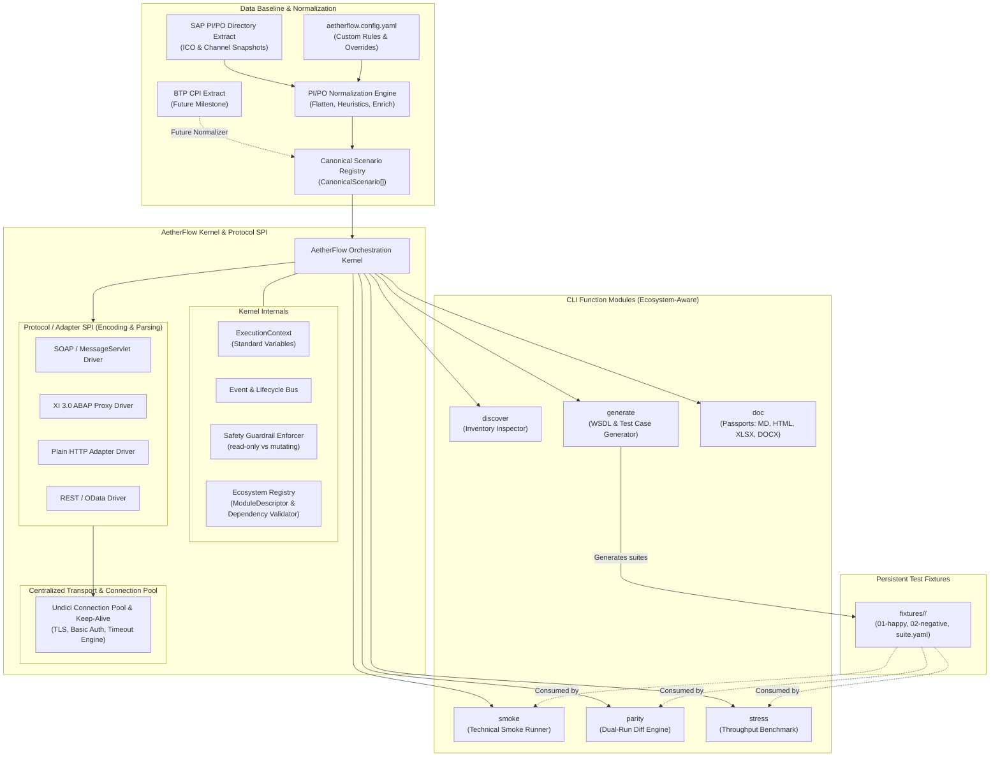
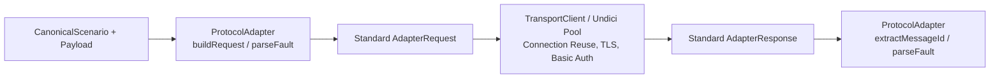
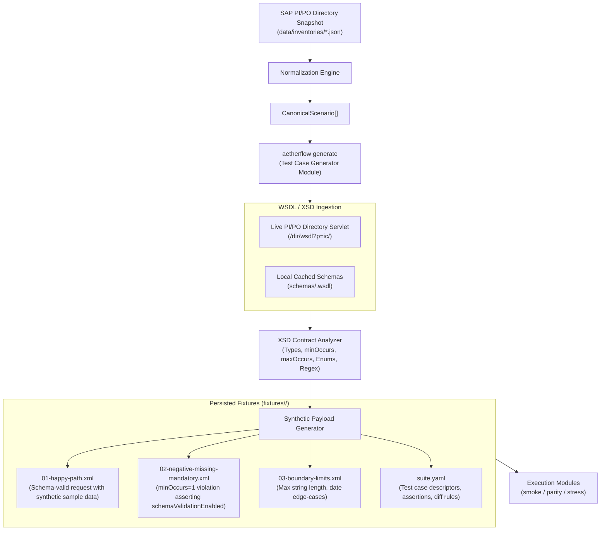
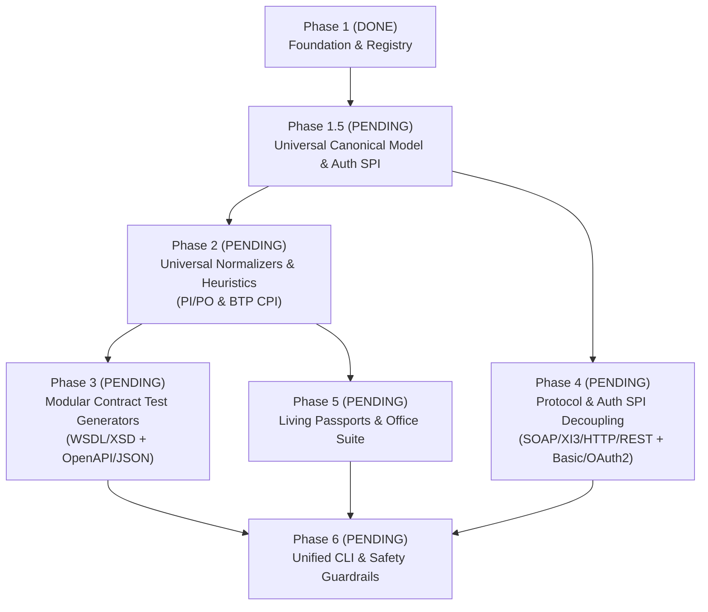

# Architecture & Canonical Scenario Specification

> **Document Status:** `ACTIVE SPECIFICATION (SSOT)`  
> **Target Version:** AetherFlow Test Engine 1.1.0+  
> **Authoritative Role:** This document is the single source of truth (SSOT) and foundational guide for all engineering implementations and AI Agent pair-programming workflows.
> **Core Focus:** Modular Engine Architecture, Extensible Ecosystem Spheres, SAP PI/PO Baseline Normalization, WSDL-Driven Test Case Generation, Protocol SPI, and Dual-Purpose Canonical Scenario Model (Automated Testing + Living Interface Documentation & SharePoint Office Exports).

---

## 1. Executive Summary & Vision

The **AetherFlow Test Engine** is an enterprise-grade test automation, parity certification, high-throughput stress benchmarking, and living documentation harness for SAP enterprise integration.

### 1.1. Core Architectural Principles
1. **Separation of Extraction vs. Execution:** 
   - **SAP PI/PO Directory Extract:** Serves as our primary baseline for interface discovery, utilizing extracted snapshots from `sap-po-ico-reader` (`data/inventories/*.json`).
   - **BTP / CPI Live Extraction:** Explicitly decoupled and pushed back to a future update (`@aetherflow/extractor-cpi`).
   - **Runtime Messaging Plane Focus:** The test harness itself does not query administrative APIs during testing; it operates purely on the messaging plane (`/XISOAPAdapter/MessageServlet`, HTTP, REST).
2. **Modular Hexagonal / Micro-Kernel Architecture:**
   - Six independent CLI functional submodules (`discover`, `generate`, `smoke`, `parity`, `stress`, `doc`).
   - Standardized context variables (`ExecutionContext`) passed across all modules.
   - Protocol / Adapter Service Provider Interface (`ProtocolAdapter` SPI) cleanly separated from the centralized HTTP transport connection pool (`TransportClient`).
   - Lightweight inter-module orchestration Kernel with lifecycle event hooks.
3. **Extensible Ecosystem Spheres & Module Manifests:**
   - Modules declare their target **Ecosystem Sphere** (`PlatformEcosystem`), operational capabilities, and prerequisite data dependencies via standardized `ModuleDescriptor` manifests.
   - Open-ended architecture: while v1.1.0 focuses on `sap-pipo`, the ecosystem model is open to future (`sap-cpi`), legacy (`sap-xi`, `sap-business-connector`), and custom middleware without architectural redesign.
4. **Decoupled, Data-Dependent Test Case Generation Pipeline:**
   - The **Test Case & Mock Payload Generator (`generate`)** is an autonomous module that is strictly **dependent on the extracted SAP PI/PO baseline inventory data**.
   - It ingests normalized interface metadata (names, namespaces, sender systems, channel bindings, and WSDL endpoints) to dynamically fetch or resolve WSDLs/XSDs and synthesize comprehensive positive, negative, and boundary test suites.
   - Once generated, test cases and fixtures are persisted independently to disk (`fixtures/<scenarioId>/`), completely decoupling subsequent test execution from live schema querying.
5. **Dual-Purpose Canonical Model (`CanonicalScenario`):**
   - The normalized data model serves both **Automated Testing** (routing keys, QoS, endpoints, verification rules, volatile fields) and **Developer & Business As-Built Documentation** (Interface Passports in Markdown, HTML, Excel `.xlsx` matrices, and Word `.docx` documents for SharePoint sign-off).

### 1.2. Current System Implementation Status & Verified Baseline

To prevent developer AI Agents from confusing in-flight architecture with completed code, the following matrix defines the authoritative baseline:

| Milestone / Subsystem | Status | Key Source Files | Test Suite & Verification | Notes |
| :--- | :---: | :--- | :--- | :--- |
| **Test Infrastructure & v1.0 Engine** | `VERIFIED` | `src/engine/*`, `src/verifier/*`, `src/protocols/*` | 11 test suites (112 tests passing) | Existing smoke, parity, and stress runners fully operational with `DiscoveredEndpoint`. |
| **Phase 1: Foundation & Ecosystem Registry** | `VERIFIED` | `src/types/scenario.ts`, `src/kernel/manifest-registry.ts` | `scenario.test.ts`, `manifest-registry.test.ts` | Manifest registry, module descriptors, and `scenarioToDiscoveredEndpoint()` bridge passing (118 tests). |
| **Phase 1.5: Platform-Neutral EIP Model & Auth SPI** | `PENDING` | `src/types/scenario.ts`, `src/types/scenario.test.ts` | Target: `scenario.test.ts` | Refactor `CanonicalScenario` to EIP terminology, decouple `icoId`, add `AuthProvider` SPI and contract formats. |
| **Phase 2: Universal Normalizers (PI/PO & BTP CPI) & Heuristics** | `PENDING` | `src/discovery/pipo-normalizer.ts`, `src/discovery/cpi-normalizer.ts`, `src/config/heuristics.ts` | Target: `pipo-normalizer.test.ts`, `cpi-normalizer.test.ts` | Multi-receiver route explosion, participant extraction, shared domain/safety heuristics. |
| **Phase 3: Modular Contract Analyzers & Test Generator** | `PENDING` | `src/generator/*` | Target: `testcase-generator.test.ts` | Manifest-driven schema generators: WSDL/XSD for PI/PO, OpenAPI/JSON and EDMX for BTP CPI. |
| **Phase 4: Protocol & Auth SPI Decoupling** | `PENDING` | `src/protocols/spi.ts`, `src/protocols/auth/*` | Target: `spi.test.ts`, `auth.test.ts` | Decouple wire formatting (`soap`, `xi3`, `http`, `rest`) and register `AuthProvider` (`basic`, `oauth2` with CSRF). |
| **Phase 5: Living Interface Passports & Office Suite** | `PENDING` | `src/reporter/passport-generator.ts`, `src/reporter/formats/*` | Target: `passport-generator.test.ts` | Generates `.md`, `.html`, `.xlsx` (exceljs), and `.docx` (docx) from platform-neutral scenarios. |
| **Phase 6: Unified CLI Integration & Safety Fence** | `PENDING` | `src/cli/index.ts`, `src/cli/commands/*` | Target: `cli.test.ts` | Exposes all 6 subcommands with ecosystem dependency validation across PI/PO and CPI. |

### 1.3. Agent Invariants, Non-Goals & Guardrails (The Straight and Narrow)

All AI Agents working on this codebase must adhere strictly to these non-negotiable architectural boundaries:

1. 🚫 **Strict Non-Goal: No Live BTP / CPI Extractor in Core**
   - The test harness does **NOT** connect to SAP BTP Cloud Integration administrative/management APIs to extract iFlow configurations.
   - CPI extraction is explicitly decoupled and slated for a future standalone package (`@aetherflow/extractor-cpi`).
   - AI Agents must never attempt to build BTP iFlow discovery or live CPI extraction code inside this repository.
2. 🚫 **Strict Non-Goal: No Administrative Directory API Calls during Test Runs**
   - Live testing operations (`smoke`, `parity`, `stress`) operate exclusively on the runtime messaging plane (`/XISOAPAdapter/MessageServlet`, HTTP, REST).
   - Agents must never introduce administrative Directory SOAP queries or CPA cache administrative calls into active test execution loops.
3. 🚫 **Strict Non-Goal (Current Phases): Backend-First Development / No Premature GUI Scaffolding**
   - **Strategy:** We are strictly following a backend-first roadmap. All core engine modules, scenario normalizers, protocol SPIs, and test runners must be developed as clean, programmatic TypeScript APIs and CLI primitives first before building the user interface.
   - **Future GUI Frontend:** A graphical user interface (web/desktop frontend) is explicitly planned for a future milestone to wrap and visually expose these capabilities. However, during the current backend milestones (Phases 1–6), AI Agents must **not** introduce Express, Fastify, Next.js, Electron, or browser UI frameworks.
   - **Architectural Requirement:** Ensure all modules, runners, and verifiers are designed as pure, programmatic library APIs returning typed result models and emitting structured lifecycle events, rather than tightly coupling logic to terminal stdout. This ensures the future GUI frontend can wrap the core engine seamlessly.
4. 🔒 **Strict Invariant: Backward Compatibility Bridge**
   - The backward-compatibility function `scenarioToDiscoveredEndpoint()` in `src/types/scenario.ts` must remain supported and verified.
   - Legacy v1.0.0 runners and their existing 112 Vitest tests **MUST NEVER** be broken or regressed during modular development.
5. 🔒 **Strict Invariant: Zero Credential Leaking**
   - All HTTP `Authorization` headers, basic auth passwords, and tokens must be masked (`***REDACTED***`) in logs, terminal output, error stacks, and generated reports.
6. 🔒 **Strict Invariant: Strict Safety Tier Guardrails**
   - Test runners must default to executing only `read-only` scenarios.
   - Any scenario marked `state-mutating` or `unknown` must be skipped unless `--allow-mutating` is explicitly passed.
   - High-throughput `stress` benchmarks on `state-mutating` scenarios strictly require BOTH `--allow-mutating` AND `--force-mutating-stress`.
   - Production hosts (`*prod*`, `*prd*`, `SPP*`) strictly require `--i-understand-this-is-production`.
7. 🔒 **Strict Invariant: Decoupled Fixture Persistence**
   - Test suites generated by `aetherflow generate` are persisted to disk under `fixtures/<scenarioId>/` (`01-happy-path.xml`, `02-negative-missing-mandatory.xml`, `03-boundary-limits.xml`, `suite.yaml`).
   - Test runners (`smoke`, `parity`, `stress`) consume these persistent fixtures without querying live WSDLs on every execution run.

---

## 2. High-Level Modular Architecture



---

### 2.2. Extensible Ecosystem Spheres, Platform Manifests & Plugin Registry

To ensure the engine can comfortably accommodate older legacy platforms, current environments, and future cloud services, modules are categorized into **Ecosystem Spheres** orchestrated by a declarative **Ecosystem Platform Manifest**.

#### 1. Open Ecosystem Specification
The ecosystem identifier is open and extensible (not restricted to a rigid closed enum):

```typescript
export type PlatformEcosystem =
  | 'sap-pipo'                // SAP NetWeaver PI/PO 7.31 - 7.5 single/dual stack
  | 'sap-cpi'                 // SAP BTP Cloud Integration / Integration Suite
  | 'sap-xi'                  // Legacy SAP XI 2.0 / 3.0 dual-stack
  | 'sap-business-connector'  // Legacy SAP Business Connector / EDI
  | 'generic-http'            // Agnostic REST / SOAP HTTP services
  | (string & {});            // Open-ended for custom or legacy enterprise middleware plugins
```

#### 2. Module Capability & Descriptor Contract
Each operational module defines a `ModuleDescriptor` that explicitly advertises its ecosystem sphere, operational capabilities, and prerequisite data requirements:

```typescript
export type ModuleCapability =
  | 'extraction'
  | 'normalization'
  | 'test-generation'
  | 'execution'
  | 'monitoring'
  | 'documentation';

export interface ModulePrerequisite {
  readonly type: 'inventory-data' | 'host-connection' | 'test-fixtures' | 'wsdl-schemas' | 'oauth2-token' | (string & {});
  readonly description: string;
}

export interface ModuleDescriptor {
  readonly id: string;                     // e.g. "generator:sap-pipo-wsdl", "runner:pipo-smoke"
  readonly name: string;
  readonly ecosystem: PlatformEcosystem;   // Sphere: 'sap-pipo', 'sap-cpi', 'sap-xi', etc.
  readonly capabilities: ModuleCapability[];
  readonly prerequisites: ModulePrerequisite[];
  readonly dependencies?: string[];        // IDs of prerequisite modules (e.g. "normalizer:sap-pipo")

  // Validates if the runtime context has the required baseline data
  validatePrerequisites(context: ExecutionContext): Promise<{ satisfied: boolean; missing: string[] }>;
}
```

#### 3. Ecosystem Platform Manifest Specification
The **Platform Manifest** defines the cluster of providers that collectively handle an ecosystem's lifecycle, establishing a single source of truth for runtime orchestration:

```typescript
export interface EcosystemDefinition {
  readonly id: PlatformEcosystem;
  readonly label: string;
  readonly description?: string;
  readonly enabled: boolean;
  
  // Capability -> Module Provider Binding
  readonly providers: {
    readonly extraction?: string;
    readonly normalization?: string;
    readonly 'test-generation'?: string;
    readonly execution?: string;
    readonly monitoring?: string;
    readonly documentation?: string;
    readonly [capability: string]: string | undefined;
  };

  // Default runtime transport protocols for this ecosystem
  readonly defaultProtocols?: string[];
}

export interface PlatformManifest {
  readonly version: string;
  readonly defaultEcosystem: PlatformEcosystem; // Default: 'sap-pipo'
  readonly ecosystems: Record<string, EcosystemDefinition>;
}
```

#### 4. Shared Test Case Generator SPI (`TestCaseGeneratorProvider`)
Parallel generator modules (e.g., PI/PO WSDL generator vs. BTP OpenAPI generator) implement a unified generator contract:

```typescript
export interface TestCaseGeneratorProvider {
  readonly id: string;                     // e.g. "generator:sap-pipo-wsdl", "generator:sap-cpi"
  readonly ecosystem: PlatformEcosystem;   // 'sap-pipo' | 'sap-cpi' | etc.
  readonly capabilities: ModuleCapability[]; // ['test-generation']
  
  validatePrerequisites(context: ExecutionContext): Promise<{ satisfied: boolean; missing: string[] }>;
  
  generateSuite(
    scenario: CanonicalScenario,
    context: ExecutionContext,
    options?: Record<string, any>
  ): Promise<{
    scenarioId: string;
    fixturesDir: string;
    generatedFiles: string[];
  }>;
}
```

#### 5. Declarative Manifest Configuration (`aetherflow.config.yaml`)
Ecosystem clusters, external plugins, and custom enterprise providers are registered in `aetherflow.config.yaml`:

```yaml
version: "1.1"

plugins:
  - "@aetherflow/plugin-btp-cpi"            # Future official BTP plugin
  - "./plugins/custom-corporate-broker.js"  # Proprietary enterprise plugin

ecosystems:
  sap-pipo:
    label: "SAP NetWeaver PI/PO 7.31 - 7.5"
    enabled: true
    providers:
      normalization: "built-in:normalizer:sap-pipo"
      test-generation: "built-in:generator:sap-pipo-wsdl"
      monitoring: "built-in:poller:pipo-message-monitoring"
      documentation: "built-in:doc:passport"

  sap-cpi:
    label: "SAP BTP Cloud Integration"
    enabled: true
    providers:
      extraction: "@aetherflow/plugin-btp-cpi:extractor"
      normalization: "@aetherflow/plugin-btp-cpi:normalizer"
      test-generation: "@aetherflow/plugin-btp-cpi:generator-openapi"
      monitoring: "@aetherflow/plugin-btp-cpi:mpl-poller"
      documentation: "built-in:doc:passport"
```

#### 6. Orchestrated Pipeline Execution Flow
When a command is executed (e.g. `aetherflow generate --scenario POS_SYSTEM_SalesOrder_OB_S4HANA`):
1. **Target Identification:** The Kernel checks `scenario.lineage.ecosystem` (e.g. `sap-pipo`).
2. **Provider Resolution:** Resolves the registered provider for capability `test-generation` matching `sap-pipo` from the `PlatformManifest`. If unregistered, halts with an actionable error (e.g., *"No provider registered for capability 'test-generation' under ecosystem 'sap-cpi'. Install '@aetherflow/plugin-btp-cpi'..."*).
3. **Prerequisite Check:** Calls `provider.validatePrerequisites(context)`. Validates baseline data and connectivity.
4. **Execution:** Dispatches execution to the resolved provider. Output is normalized to standard directories (`fixtures/<scenarioId>/`).

---

## 3. The `CanonicalScenario` Specification

The `CanonicalScenario` is the central contract of the entire platform. Every module (testing, benchmarking, documentation, or test-case generation) consumes this schema.

### 3.1. Cardinality & Multi-Receiver Normalization
In enterprise middleware (SAP PI/PO ICOs or SAP BTP CPI iFlows with multicast / router branches), a single integration artifact can define multiple receiver determinations or branching routes. To guarantee deterministic testing, targeted parity diffing, and discrete documentation passports:
- The normalization engine **explodes multi-receiver configurations into 1:1 sender-to-receiver `CanonicalScenario` instances**.
- Each scenario retains its parent lineage (`lineage.sourceArtifactId`) and `routeIndex` to maintain provenance and grouping while operating independently at runtime.

### 3.2. TypeScript Interface Contract (Universal EIP Specification)

```typescript
export type QualityOfService = 'BE' | 'EO' | 'EOIO';
export type ScenarioSafetyTier = 'read-only' | 'state-mutating' | 'unknown';
export type IntegrationPattern =
  | 'sync-request-reply'
  | 'async-event-message'
  | 'async-batch-file'
  | 'database-integration';

export type ContractFormat =
  | 'wsdl'
  | 'xsd'
  | 'openapi'
  | 'json-schema'
  | 'edmx'
  | 'opaque';

export interface CanonicalScenario {
  // ========================================================
  // 1. Identity, Governance & Provenance
  // ========================================================
  id: string;                               // Unique deterministic key: "<Sender>_<Interface>_<Receiver>[_<routeIndex>]"
  name: string;                             // Interface or iFlow Name (e.g. "SalesOrder_OB")
  namespace?: string;                       // Business Namespace URI (optional in REST/CPI flows)
  description?: string;                     // Functional summary or business narrative
  functionalDomain: string;                 // Inferred domain (e.g. "Sales & Distribution (SD)")
  integrationPattern: IntegrationPattern;   // Universal EIP architectural pattern
  
  // Provenance & Source Metadata
  lineage: {
    ecosystem: PlatformEcosystem;           // 'sap-pipo' | 'sap-cpi' | 'generic-http'
    sourceArtifactType: 'ICO' | 'iFlow' | 'InterfaceDetermination' | string;
    sourceArtifactId: string;               // ICO GUID, iFlow ID, or technical artifact identifier
    sourceContainer?: string;               // PI/PO Folder path or BTP CPI Package ID
    version?: string;                       // Artifact version or revision timestamp
    sourceInventoryId?: string;             // Inventory snapshot UUID
  };

  routeIndex?: number;                      // 0-based receiver route index (for multi-route scenarios)
  totalRoutes?: number;                     // Total receiver routes in parent artifact

  lastChanged?: {
    user: string;                           // Account ID of last modifier
    timestamp: string;                      // ISO 8601 timestamp
  };

  // ========================================================
  // 2. Ingress & Runtime Dispatch Specification
  // ========================================================
  routing: {
    sender: string;                         // Sender System / Participant (e.g. "BC_DMALL", "Shopify")
    senderParty?: string;                   // Sender Party / Organization (if applicable)
    receiver: string;                       // Receiver System / Participant (e.g. "S4HANA", "WMS")
    receiverParty?: string;                 // Receiver Party / Organization (if applicable)
    qos: QualityOfService;                  // BE (Best Effort), EO (Exactly Once), EOIO (In Order)
    queueName?: string;                     // Queue name (present when QoS = EOIO or JMS queue)
    conditionFilter?: string;               // Content-based routing XPath, header expr, or Camel condition
  };

  runtimeEndpoint: {
    protocol: EndpointProtocol;             // 'soap' | 'http' | 'rest' | 'xi3'
    path: string;                           // Relative URL path (e.g. "/XISOAPAdapter/..." or "/http/orders")
    httpMethod: 'POST' | 'GET' | 'PUT';
    requiredHeaders: Record<string, string>;
    schemaValidationEnabled: boolean;
    auth?: {
      type: 'basic' | 'oauth2' | 'client-cert' | 'none';
      csrfProtection?: boolean;             // Flag indicating CSRF token pre-flight handshake requirement
    };
  };

  // ========================================================
  // 3. Schema & Interface Contract Specification
  // ========================================================
  contract?: {
    format: ContractFormat;
    url?: string;                           // Remote schema/contract URL (e.g. Directory WSDL, Swagger)
    filePath?: string;                      // Path to cached or local contract file
    rootEntity?: string;                    // Top-level request XML element name or JSON Schema model
    targetNamespace?: string;               // Target XML schema namespace
  };

  // ========================================================
  // 4. Technical As-Built Architecture (EIP Adapters)
  // ========================================================
  inboundAdapter: {
    name: string;                           // Channel or Adapter Name
    adapterType: string;                    // "SOAP", "HTTPS", "SFTP", "REST", "KAFKA", etc.
    transport: string;                      // "HTTP", "SSHFtp", "RFC", etc.
    protocol: string;                       // "SOAP 1.1", "JSON", "XI 3.0", "OData V2", etc.
    attributes: Record<string, any>;        // Flattened configuration parameters
    pipeline?: Array<{
      step: number;
      name: string;
      type: string;                         // "JavaModule", "GroovyScript", "ContentModifier", etc.
      description?: string;
    }>;
  };

  transformation?: {
    name?: string;                          // Operation Mapping or Script identifier
    engine?: 'graphical-mapping' | 'xslt' | 'groovy-script' | 'javascript' | 'passthrough';
    targetInterface?: string;
    targetNamespace?: string;
  };

  outboundAdapter?: {
    name: string;
    adapterType: string;
    endpointUrl?: string;                   // Backend target URL, RFC destination, or broker address
    transport: string;
    protocol: string;
    attributes?: Record<string, any>;
  };

  // ========================================================
  // 5. Testing & Verification Rules (Execution Engine)
  // ========================================================
  testing: {
    safetyTier: ScenarioSafetyTier;         // 'read-only' vs 'state-mutating' vs 'unknown'
    timeoutMs: number;                      // Per-interface SLA timeout threshold
    payloadFixturesDir?: string;            // Path to golden test payloads
    volatileFieldIgnores: string[];         // Fields stripped during canonical diffing
    expectedTerminalStatus: 'DELIVERED' | 'WAITING' | 'COMPLETED'; // PI/PO vs CPI status
    responseType: 'xml' | 'json' | 'opaque';
  };

  // ========================================================
  // 6. Dual-Run Parity Specification (Pre-to-Post Migration)
  // ========================================================
  parity?: {
    targetEcosystem: PlatformEcosystem;     // e.g. 'sap-cpi'
    targetPath?: string;                    // Relative endpoint path on target system
    targetScenarioId?: string;              // Direct link to target CanonicalScenario ID
    httpMethod?: 'POST' | 'GET';
  };
}
```

### 3.3. Raw Inventory Extraction Contracts (`src/types/raw-inventory.ts`)
To eliminate dynamic typing ambiguity, raw JSON inventory files exported by `sap-po-ico-reader` conform to strict structural interfaces:
- `RawIntegratedConfiguration`: Typed ICO representation encompassing `IntegratedConfigurationID`, `AdministrativeData`, `InboundProcessing`, `Receivers`, `ReceiverInterfaces`, `OutboundProcessing`, and `Logging`.
- `RawCommunicationChannel`: Typed communication channel representation containing `CommunicationChannelID`, `Direction`, `TransportProtocol`, `MessageProtocol`, `AdapterSpecificAttribute[]`, `AdapterSpecificTableAttribute[]`, `ModuleProcess`, and `AdministrativeData`.
- `toArray<T>(item)`: Resilient utility ensuring single-child XML elements deserialized as objects are safely treated as standard JavaScript arrays.

### 3.4. Multi-Receiver Route Explosion & Correlation Algorithm
In SAP PI/PO, one Integrated Configuration frequently routes messages to multiple backends (e.g. S/4HANA for processing, WMS for logistics, and CRM for customer sync). To achieve targeted test assertions and discrete living documentation passports, the normalizer executes this deterministic correlation:

1. **Receiver Branch Traversal:** Iterates over all receiver entries in `toArray(ico.ReceiverInterfaces)`.
2. **Outbound Processing Match:** For each receiver entry, locates the corresponding `RawOutboundProcessing` entry where:
   - `outbound.Receiver.ComponentID === receiverEntry.Receiver.ComponentID`
   - `outbound.Receiver.PartyID === receiverEntry.Receiver.PartyID`
   - *(If specified)* `outbound.ReceiverInterface.Name === receiverRule.Interface.Name`
3. **Channel Dereferencing:**
   - Inbound channel key in `ico.InboundProcessing` $\rightarrow$ resolved from `inventory.communicationChannels`.
   - Outbound channel key in `matchedOutbound.CommunicationChannel` $\rightarrow$ resolved from `inventory.communicationChannels`.
4. **Deterministic Scenario ID:**
   - Single route: `${senderComponent}_${interfaceName}_${receiverComponent}`
   - Multiple routes: `${senderComponent}_${interfaceName}_${receiverComponent}_route${routeIndex}`
5. **Content-Based Routing Capture:** When `ReceiverRule.Condition.XPath` is present, records the routing filter in `CanonicalScenario.routing.conditionXPath`.

### 3.5. Telemetry & Monitoring Provider SPI (`TelemetryPollerProvider`)
Asynchronous telemetry verification varies by integration platform (`AdapterMessageMonitoring` in PI/PO vs. `MessageProcessingLogs` in CPI). Platforms register telemetry pollers via the `TelemetryPollerProvider` SPI in `src/types/scenario.ts`:

```typescript
export interface TelemetryPollerProvider {
  readonly id: string;
  readonly ecosystem: PlatformEcosystem;
  readonly capabilities: ModuleCapability[]; // ['monitoring']

  pollStatus(
    messageId: string,
    context: ExecutionContext,
    options?: {
      maxWaitMs?: number;
      initialDelayMs?: number;
      maxDelayMs?: number;
      abortSignal?: AbortSignal;
    }
  ): Promise<AsyncPollResult>;
}
```

---

## 4. Automatic Heuristics & Declarative Configuration

To minimize manual configuration while supporting custom enterprise landscapes, AetherFlow combines deterministic heuristics with an optional declarative configuration file.

### 4.1. Automatic Heuristics
1. **Functional Domain Inference:**
   - `*Sales*`, `*SD*`, `*Order*` $\rightarrow$ **Logistics: Sales & Distribution (SD)**
   - `*Finance*`, `*FI*`, `*Payment*`, `*Tax*` $\rightarrow$ **Finance & Controlling (FI/CO)**
   - `*Procure*`, `*MM*`, `*Purchas*`, `*Vendor*` $\rightarrow$ **Procurement & Materials Management (MM)**
   - `*Warehouse*`, `*WMS*`, `*Inventory*` $\rightarrow$ **Supply Chain & Warehousing (SCM)**
   - `*HR*`, `*Employee*`, `*Payroll*` $\rightarrow$ **Human Resources (HCM)**
2. **Integration Pattern Classification:**
   - `SOAP` or `HTTP` or `REST` + `QoS == 'BE'` $\rightarrow$ **Synchronous Request/Reply API (`sync-request-reply`)**
   - `SOAP` or `XI` or `RFC` or `IDOC` + `QoS == 'EO' | 'EOIO'` $\rightarrow$ **Asynchronous Event/Message (`async-event-message`)**
   - `File` or `SFTP` + `QoS == 'EO'` $\rightarrow$ **Asynchronous Batch File Transfer (`async-batch-file`)**
   - `JDBC` $\rightarrow$ **Database Integration (`database-integration`)**
3. **Safety & Mutability Classification:**
   - Names containing `Get*`, `Read*`, `Query*`, `Fetch*`, `Status*`, `Search*` $\rightarrow$ **`read-only`**
   - Names containing `Create*`, `Post*`, `Update*`, `Cancel*`, `Submit*`, `Process*` $\rightarrow$ **`state-mutating`**
   - All other interfaces $\rightarrow$ **`unknown`**

### 4.2. Declarative Configuration File (`aetherflow.config.yaml`)
Custom rules and scenario overrides can be defined in `aetherflow.config.yaml` or `.aetherflow.yaml`:

```yaml
# AetherFlow Custom Rules & Overrides
version: "1.1"

heuristics:
  domainRules:
    - pattern: ".*crm.*"
      domain: "Customer Relationship Management (CRM)"
    - pattern: ".*mes.*|.*shopfloor.*"
      domain: "Manufacturing Execution System (MES)"
  safetyRules:
    - pattern: ".*_SIMULATE$|.*_CHECK$"
      tier: "read-only"
    - pattern: ".*_EXECUTE$"
      tier: "state-mutating"

parity:
  cpiEndpointPattern: "/http/{senderComponent}/{interfaceName}"
  cpiEndpointOverrides:
    POS_SYSTEM_SalesOrder_OB_S4HANA: "/http/v2/SalesOrders"

scenarios:
  POS_SYSTEM_SalesOrder_OB_S4HANA:
    safetyTier: "read-only" # Override for test environment
    timeoutMs: 15000
    volatileFieldIgnores:
      - "orderId"
      - "createdTimestamp"
      - "sessionId"
```

#### TypeScript Schema Contract (`src/config/aetherflow-config.ts`)
```typescript
export interface HeuristicRule {
  pattern: string;
  domain?: string;
  tier?: ScenarioSafetyTier;
  patternType?: IntegrationPattern;
}

export interface ScenarioOverrideConfig {
  safetyTier?: ScenarioSafetyTier;
  timeoutMs?: number;
  cpiEndpointPath?: string;
  volatileFieldIgnores?: string[];
  customHeaders?: Record<string, string>;
  expectedTerminalStatus?: 'DELIVERED' | 'WAITING';
}

export interface AetherFlowConfig {
  version: string;
  plugins?: string[];
  ecosystems?: Record<string, Partial<EcosystemDefinition>>;
  heuristics?: {
    domainRules?: HeuristicRule[];
    safetyRules?: HeuristicRule[];
    patternRules?: HeuristicRule[];
  };
  parity?: {
    cpiEndpointPattern?: string;
    cpiEndpointOverrides?: Record<string, string>;
  };
  scenarios?: Record<string, ScenarioOverrideConfig>;
}

export async function loadAetherFlowConfig(searchDir?: string): Promise<AetherFlowConfig | null>;
```

#### Configuration Precedence & Graceful Degradation
1. **Hierarchical Precedence:** $\text{CLI Options} > \text{Scenario Overrides} > \text{Heuristic Rules} > \text{Built-in Defaults}$.
2. **Graceful Fallback:** If `aetherflow.config.yaml` is absent, the engine falls back to built-in heuristics with zero warnings. If YAML syntax is malformed, the loader logs an actionable `[WARN]` to stderr and safely falls back without crashing.

---

### 4.3. Strict Safety Guardrail Enforcement Policy
To protect non-production and staging SAP environments from accidental database mutations or ERP document generation:
- **Default Policy:** Test runners (`smoke`, `stress`) **only execute `read-only` scenarios**.
- **Mutating & Unknown Scenarios:** Automatically skipped with an explicit console warning unless the `--allow-mutating` flag is explicitly provided.
- **High-Throughput Stress Benchmarks:** Executing stress benchmarks on `state-mutating` scenarios strictly requires both flags: `--allow-mutating --force-mutating-stress`.

---

## 5. Protocol / Adapter SPI & Centralized Transport

To avoid duplicating connection pooling, authentication, and TLS logic across adapters, AetherFlow cleanly separates **wire message formatting** from **network transport**.



### 5.1. Interface Contracts

```typescript
export interface AdapterRequest {
  url: string;
  method: 'GET' | 'POST' | 'PUT';
  headers: Record<string, string>;
  body?: string | Buffer;
  timeoutMs: number;
}

export interface AdapterResponse {
  statusCode: number;
  statusText: string;
  headers: Record<string, string>;
  body: string;
  durationMs: number;
}

/**
 * Pure encoding/decoding and fault parsing interface.
 * Stateless; does not handle socket connections directly.
 */
export interface ProtocolAdapter {
  readonly protocolId: string; // e.g. "xi3", "soap", "http", "rest"

  // Encodes scenario and payload into protocol wire request
  buildRequest(scenario: CanonicalScenario, rawPayload: string, customHeaders?: Record<string, string>): AdapterRequest;

  // Extracts SAP MessageID for asynchronous EO telemetry tracking
  extractMessageId(response: AdapterResponse): string | undefined;

  // Detects and parses SOAP Faults / error categories
  parseFault(response: AdapterResponse): {
    isFault: boolean;
    code?: string;
    message?: string;
    detail?: string;
  };
}
```

### 5.2. Built-in Adapters
- `soap`: Standard SAP `/XISOAPAdapter/MessageServlet` with query parameters.
- `xi3`: SOAP Envelope with `<soapenv:Header><xi:Main xmlns:xi="http://sap.com/xi/XI/Message/30">` headers for SAP S/4HANA proxy simulation.
- `http`: Direct query via `/HttpAdapter/HttpMessageServlet`.
- `rest`: Direct REST invocation via `/RESTAdapter/...`.

---

## 6. Automated Test Case & Mock Payload Generator Module (`generate`)

The **Test Case & Mock Payload Generator** is an independent functional module designed to solve the payload provisioning bottleneck for SAP enterprise testing.

### 6.1. Architectural Data Dependency & Prerequisites
The `generate` module operates downstream of extraction and normalization:
- **Strict Data Dependency:** It relies directly on the extracted SAP PI/PO inventory baseline (`data/inventories/*.json`). It consumes normalized [`CanonicalScenario`](#3-the-canonicalscenario-specification) objects to know which interfaces exist, their routing parameters, their sender channels, and their schema validation settings.
- **Execution Decoupling:** Once generated, test cases and fixtures are persisted into the local filesystem under `fixtures/<scenarioId>/`. Test runners (`smoke`, `parity`, `stress`) consume these persistent fixtures without needing to re-fetch schemas or query WSDL endpoints on every test run.



### 6.2. WSDL & Schema Sourcing Mechanisms
1. **Dynamic Live SAP PI/PO Extraction:**
   - Connects to the SAP PI/PO host using configured credentials.
   - Queries the standard Directory WSDL servlet using exact key patterns:
     - **Service Interface Query (Primary):**  
       `http(s)://<host>:<port>/dir/wsdl?p=sa/<InterfaceName>&ns=<InterfaceNamespace>`
     - **ICO 6-Part Binding Query (Secondary):**  
       `http(s)://<host>:<port>/dir/wsdl?p=ic/<SenderParty>/<SenderComponent>/<InterfaceName>/<InterfaceNamespace>/<ReceiverParty>/<ReceiverComponent>`
   - Saves fetched WSDL and embedded/referenced XSD definitions locally into `schemas/<scenarioId>/`.
2. **Offline Local Schema Lookup:**
   - If offline or air-gapped, the generator checks for pre-extracted schemas in `./schemas/<scenarioId>.wsdl`, `./schemas/<InterfaceName>.wsdl`, or `./schemas/<InterfaceName>.xsd`.

### 6.3. Schema Contract Analysis & Synthesis Boundaries
The XSD engine parses the root request element and constructs a typed schema tree, evaluating:
- **Mandatory vs. Optional Elements:** `minOccurs >= 1` vs `minOccurs="0"`.
- **Primitive Data Types:** `xs:string`, `xs:date`, `xs:dateTime`, `xs:integer`, `xs:decimal`, `xs:boolean`.
- **Value Constraints:** `xs:enumeration` (picks valid enum values), `xs:maxLength`, `xs:pattern` (regex-driven sample values).

#### Synthesis Boundary Invariants
To prevent infinite loops and payload bloat on complex enterprise SAP schemas:
1. **Recursion Depth Cap:** Maximum nesting depth is strictly capped at **5 levels**. Any recursive or cyclic type exceeding depth 5 terminates with an empty element or primitive fallback.
2. **Array Multiplicity:** For elements with `maxOccurs="unbounded"` or `maxOccurs > 1`, the generator synthesizes exactly **2 distinct instances** with unique index values to verify array serialization without payload bloat.
3. **Negative Test Generation (`02-negative-missing-mandatory.xml`):** Identifies the first non-root element where `minOccurs >= 1` and deliberately omits it, asserting adapter engine schema validation rejection.

#### Test Suite Manifest Contract (`fixtures/<scenarioId>/suite.yaml`)
```typescript
export interface TestCaseDescriptor {
  id: string;                                // e.g. "01-happy-path", "02-negative-missing-mandatory"
  title: string;
  file: string;                              // Relative path to fixture file: "01-happy-path.xml"
  type: 'positive' | 'negative' | 'boundary';
  expectedStatusCode: number;                // Expected HTTP status code (200, 400, 500)
  expectedIsFault: boolean;                  // True if this test expects a SOAP Fault or error
  expectedFaultCode?: string;                // e.g. "SERVER.SYSTEM_ERROR"
  expectedAsyncStatus?: 'DELIVERED' | 'WAITING' | 'SYSTEM_ERROR';
  timeoutMs?: number;
}

export interface TestSuiteManifest {
  scenarioId: string;
  ecosystem: PlatformEcosystem;
  generatedAt: string;
  schemaSource: string;                      // WSDL URL or local schema filename
  testCases: TestCaseDescriptor[];
  volatileFieldIgnores: string[];
  customHeaders?: Record<string, string>;
}
```

From this analysis, the generator produces four core test assets in `fixtures/<scenarioId>/`:
1. **`01-happy-path.xml`:** Fully populated, schema-valid request payload with realistic synthetic data adhering to all data types and enumeration constraints.
2. **`02-negative-missing-mandatory.xml`:** Deliberate omission of required fields (`minOccurs="1"`), verifying that interfaces configured with `schemaValidationEnabled: true` correctly reject invalid payloads at the Adapter Engine before hitting backend ERP systems.
3. **`03-boundary-limits.xml`:** Extreme edge-case values (e.g. `maxLength` strings, maximum numeric values) to verify buffer limits and truncation handling.
4. **`suite.yaml`:** Test case manifest declaring expected HTTP response codes (e.g. `200` vs `500`), expected SOAP Fault codes, and scenario-specific volatile field ignore paths.

### 6.4. CLI Usage
```bash
# Auto-discover WSDLs and generate test suites for all interfaces in an inventory
$ aetherflow generate --inventory ./inventories/sap-prod-inventory.json --host dev-pipo --output ./fixtures/

# Generate test suite for a specific interface
$ aetherflow generate --scenario POS_SYSTEM_SalesOrder_OB_S4HANA --host dev-pipo

# Generate offline using local schemas
$ aetherflow generate --inventory ./inventories/sap-prod-inventory.json --schemas-dir ./schemas/
```

---

## 7. Test Fixture & Payload Strategy

AetherFlow adopts a **Hybrid Payload Strategy** to allow immediate testing across all maturity levels:
1. **Smoke Tests (Zero-Config Minimal Synthetic Payloads):**
   - If no fixture exists on disk and WSDL generation has not been run, the engine auto-generates a minimal schema-valid XML root envelope (`<ns:<InterfaceName> xmlns:ns="<InterfaceNamespace>"/>`) to verify adapter reachability, CPA cache synchronization, and channel activation.
2. **WSDL-Generated Test Suites (Standardized Fixtures):**
   - Once `aetherflow generate` has run, test runners prioritize the schema-valid `01-happy-path.xml` and negative test cases.
3. **Golden Production Fixtures (Pre-to-Post Migration Parity):**
   - Handcrafted or production-recorded payloads can be saved in `fixtures/<scenarioId>/request.xml` or supplied via `--payload <path>`.

---

## 8. Living Interface Documentation & SharePoint Office Exports

The `doc` module transforms normalized `CanonicalScenario` records into a multi-channel documentation suite designed for both engineering Git repositories and corporate SharePoint repositories.

### 8.1. Artifact Formats & Capabilities
1. **Git-Centric Markdown Passports (`.md`):**
   - Located at `docs/passports/<scenarioId>.md`.
   - Includes **Mermaid Sequence Diagrams**, verified as-built configuration tables, ready-to-run cURL commands, and Day-2 PIMON triage runbooks.
   - Master navigable `INDEX.md` grouped by functional domain.
2. **Interactive HTML Catalog (`.html`):**
   - Standalone searchable HTML documentation bundle with built-in dark/light mode and interactive diagrams.
3. **Master Excel Interface Inventory Matrix (`.xlsx` via `exceljs`):**
   - Tabular master register for enterprise architecture and audit teams.
   - **Sheet 1: `Master Inventory` Columns:**
     1. `Scenario ID` (e.g. `POS_SYSTEM_SalesOrder_OB_S4HANA`)
     2. `Lineage (ICO ID)`
     3. `Functional Domain` (e.g. `Logistics: Sales & Distribution (SD)`)
     4. `Interface Name`
     5. `Interface Namespace`
     6. `Sender Component`
     7. `Sender Channel`
     8. `Receiver Component`
     9. `Receiver Channel`
     10. `Quality of Service` (`BE` / `EO` / `EOIO`)
     11. `Safety Tier` (`read-only` / `state-mutating` / `unknown`)
     12. `Integration Pattern`
     13. `Last Changed Date`
     14. `Last Changed User`
   - **Styling:** Corporate Navy Header (`#1A365D`), white bold text, auto-filter on row 1, frozen top row (`freezePanes: { row: 1 }`).
   - **Conditional Formatting:** Soft Green (`#C6F6D5`) for `read-only`, Amber (`#FEEBC8`) for `unknown`, Soft Red (`#FED7D7`) for `state-mutating`.
   - **Sheets 2–N:** Filtered domain worksheets for each detected functional domain (`SD`, `FI-CO`, `MM`, `SCM`, `HCM`).
4. **Individual Word Interface Specifications (`.docx` via `docx`):**
   - Professional Word document formatted for direct upload to Microsoft SharePoint or OpenText.
   - **Document Layout & Sections:**
     1. **Cover & Metadata Block:** Document title, Interface Name, Domain, Safety Tier badge, Last Change timestamp, and Author ID.
     2. **Executive Overview:** Human-friendly summary of the interface and business process.
     3. **Technical As-Built Specification:** Inbound channel details, adapter type, transport/message protocol, module chains, ESR mapping name/namespace, and outbound channel details.
     4. **Runtime Testing Specification:** Complete runtime endpoint URL path, required headers, and ready-to-execute cURL command snippet.
     5. **Operational Day-2 Runbook:** PIMON search attributes, error categorization, escalation paths, and retry guidelines.
     6. **Formal Enterprise Sign-Off Table:** Columns: `Role` (Enterprise Architect, Integration Lead, Business Process Owner), `Name`, `Signature`, `Date`, `Approval Status`.

### 8.2. CLI Usage
```bash
# Generate all formats (Markdown, HTML, Excel matrix, Word specs)
$ aetherflow doc --inventory ./inventories/sap-prod-inventory.json --output ./docs/passports/ --all-formats

# Generate only Excel matrix for SharePoint
$ aetherflow doc --inventory ./inventories/sap-prod-inventory.json --output ./docs/passports/ --format xlsx

# Generate passport for a single interface
$ aetherflow doc --inventory ./inventories/sap-prod-inventory.json --interface SalesOrder_OB --format md,docx
```

## 9. Implementation Roadmap & Phase-by-Phase Technical Blueprint

To ensure any developer or AI Agent stays on the straight and narrow, this section establishes the authoritative technical blueprint for each implementation phase. Each phase defines target source files, input/output contracts, dependencies, and verification criteria.



---

### Phase 1: Foundation Types & Ecosystem Registry `[VERIFIED / COMPLETED]`
* **Status:** `COMPLETED` (100% test coverage, 118 passing Vitest tests).
* **Target Files:**
  * `src/types/scenario.ts` — Type definitions for initial `CanonicalScenario`, `PlatformManifest`, `EcosystemDefinition`, `ModuleDescriptor`, `TestCaseGeneratorProvider`, and `scenarioToDiscoveredEndpoint()`.
  * `src/kernel/manifest-registry.ts` — `EcosystemRegistry` managing manifests, module descriptors, provider instances, and prerequisite validation.
  * `src/types/scenario.test.ts` — Unit tests for scenario typing and endpoint conversion bridge.
  * `src/kernel/manifest-registry.test.ts` — Unit tests for registration, resolution, missing provider errors, and prerequisite checking.
* **Invariant Guard:** The backward-compatibility function `scenarioToDiscoveredEndpoint()` bridges the canonical model with legacy runners, preventing test regressions.

---

### Phase 1.5: Universal EIP Canonical Model & AuthProvider SPI `[PENDING]`
* **Status:** `PENDING IMPLEMENTATION`
* **Target Files:**
  * `src/types/scenario.ts` — Refactor `CanonicalScenario` to platform-neutral EIP terminology:
    * Remove top-level `icoId` in favor of universal `lineage` (`sourceArtifactType: 'ICO' | 'iFlow'`, `sourceArtifactId`, `sourceContainer`, `version`).
    * Generalize `runtimeEndpoint.servletPath` to `path`, add declarative `auth?: { type, csrfProtection }`.
    * Rename `inboundChannel` / `outboundChannel` to `inboundAdapter` / `outboundAdapter` with generic `transport`, `protocol`, and `pipeline`.
    * Introduce `ContractFormat` (`wsdl`, `xsd`, `openapi`, `json-schema`, `edmx`, `opaque`) on `contract`.
    * Generalize `parity` to `targetEcosystem`, `targetPath`, and `targetScenarioId`.
    * Introduce `AuthProvider` SPI contract (`buildAuthHeaders()`, `preFlightHandshake()`).
  * `src/types/scenario.test.ts` — Unit tests verifying the refactored schema, dual PI/PO & CPI mock scenarios, and strict `scenarioToDiscoveredEndpoint()` backward compatibility.
* **Key Responsibilities:**
  1. Eliminate NetWeaver- and BTP-specific terminology from the root canonical schema.
  2. Maintain 100% backward compatibility for all existing 118 tests.

---

### Phase 2: Universal Normalizers (PI/PO & BTP CPI) & Configuration Heuristics `[PENDING]`
* **Status:** `PENDING IMPLEMENTATION`
* **Target Files:**
  * `src/discovery/pipo-normalizer.ts` — Primary PI/PO normalization engine (`built-in:normalizer:sap-pipo`).
  * `src/discovery/cpi-normalizer.ts` — Primary BTP CPI bundle/artifact normalizer (`built-in:normalizer:sap-cpi`).
  * `src/config/heuristics.ts` — Shared pattern matching and heuristic inference rules.
  * `src/discovery/pipo-normalizer.test.ts` — Unit tests for PI/PO scenario normalization.
  * `src/discovery/cpi-normalizer.test.ts` — Unit tests for BTP CPI scenario normalization.
* **Input Contract:**
  * PI/PO: `icos: IcoRecord[]`, `channels: ChannelRecord[]` (loaded via `InventoryLoader`).
  * CPI: `artifacts: RawCpiArtifact[]` (offline exported iFlow metadata/bundle).
  * Shared: `config?: AetherFlowConfig` (from `aetherflow.config.yaml` or `.aetherflow.yaml`).
* **Output Contract:** `CanonicalScenario[]`
* **Key Responsibilities:**
  1. **PI/PO Multi-Receiver Explosion:** Ingest 1:N receiver determinations in an ICO and explode them into 1:1 `CanonicalScenario` records: `<Sender>_<Interface>_<Receiver>[_<routeIndex>]`.
  2. **CPI Participant & Route Extraction:** Ingest iFlow sender/receiver channels, participants, and Camel routes into 1:1 `CanonicalScenario` records: `<Sender>_<iFlowId>_<Receiver>`.
  3. **Universal Heuristics Classification:** Infer `functionalDomain` (SD, FI/CO, MM, SCM, HCM), `integrationPattern` (`sync-request-reply`, `async-event-message`, `async-batch-file`, `database-integration`), and `safetyTier` (`read-only`, `state-mutating`, `unknown`).
  4. **Config Rule Overrides:** Apply user-defined regex rules and scenario-level overrides from `aetherflow.config.yaml` with highest precedence.
  5. **Adapter Mapping:** Flatten channel/adapter parameters and module/Camel pipelines into `inboundAdapter` and `outboundAdapter`.
* **Target Vitest Assertions:** Route explosion cardinality, CPI participant extraction, domain heuristic correctness, safety tier assignment, config override precedence, and `scenarioToDiscoveredEndpoint()` compatibility.

---

### Phase 3: Modular Contract Analyzers & Test Case Generator `[PENDING]`
* **Status:** `PENDING IMPLEMENTATION`
* **Target Files:**
  * `src/generator/testcase-generator.ts` — Implements `TestCaseGeneratorProvider` master dispatcher.
  * `src/generator/generators/wsdl-generator.ts` — WSDL/XSD generator for PI/PO & SOAP interfaces (`built-in:generator:sap-pipo-wsdl`).
  * `src/generator/generators/openapi-generator.ts` — OpenAPI/JSON-Schema generator for REST interfaces (`built-in:generator:openapi-json`).
  * `src/generator/xsd-synthesizer.ts` — Evaluates XSD AST and generates mock XML payloads.
  * `src/generator/testcase-generator.test.ts` — Unit and integration tests.
* **Input Contract:** `scenario: CanonicalScenario`, `context: ExecutionContext`.
* **Output Contract:** `TestCaseGenerationResult` writing to `fixtures/<scenarioId>/`:
  * `01-happy-path.xml` / `01-happy-path.json` — Schema-valid payload satisfying primitive types, lengths, and enumeration constraints.
  * `02-negative-missing-mandatory.xml` / `.json` — Omission of mandatory elements asserting adapter engine rejection.
  * `03-boundary-limits.xml` / `.json` — Max-length strings and boundary numeric values.
  * `suite.yaml` — Test manifest declaring expected HTTP response codes, SOAP Fault codes, and volatile field ignore paths.
* **Key Responsibilities:**
  1. Live fetch via Directory WSDL or local fallback `./schemas/<scenarioId>.*`.
  2. Support multiple contract formats based on manifest bindings (WSDL for PI/PO, OpenAPI/JSON for CPI REST).
  3. Decouple test generation from live test runs: test runners read persisted fixtures from disk.
* **Target Vitest Assertions:** Live WSDL mock fetching, offline schema fallback, synthetic XML/JSON validation, negative test payload structure, and file generation to `fixtures/`.

---

### Phase 4: Protocol & Authentication SPI Decoupling `[PENDING]`
* **Status:** `PENDING IMPLEMENTATION`
* **Target Files:**
  * `src/protocols/spi.ts` — `ProtocolAdapter` and `ProtocolRegistry`.
  * `src/protocols/auth/auth-spi.ts` — `AuthProvider` and `AuthRegistry`.
  * `src/protocols/adapters/soap-adapter.ts` — SAP `/XISOAPAdapter/MessageServlet` query driver.
  * `src/protocols/adapters/xi3-adapter.ts` — SOAP Envelope with `<xi:Main>` headers (ABAP proxy driver).
  * `src/protocols/adapters/http-adapter.ts` — Plain HTTP driver.
  * `src/protocols/adapters/rest-adapter.ts` — REST driver.
  * `src/protocols/auth/basic-auth.ts` — HTTP Basic Auth handler (`built-in:auth:basic`).
  * `src/protocols/auth/oauth2-auth.ts` — BTP XSUAA OAuth2 client-credentials handler with token TTL caching and CSRF token pre-flight (`built-in:auth:sap-cpi-oauth2`).
  * `src/protocols/spi.test.ts`, `src/protocols/auth/auth.test.ts` — Unit tests.
* **Key Responsibilities:**
  1. Decouple wire message encoding/decoding and fault detection from `TransportClient` connection pool (`UndiciPool`).
  2. Decouple authentication negotiation and CSRF pre-flight handshakes from the protocol drivers into ecosystem-registered `AuthProvider` modules.
  3. Ensure existing v1.0 `soap-message-builder.ts` and `response-parser.ts` are cleanly preserved or delegated to maintain full test compatibility.
* **Target Vitest Assertions:** Correct query string generation for SOAP, XML envelope wrapping for XI 3.0, OAuth2 token caching, CSRF preflight token caching, SOAP 1.1/1.2 fault parsing, and MessageID extraction.

---

### Phase 5: Living Interface Passports & Office Suite `[PENDING]`
* **Status:** `PENDING IMPLEMENTATION`
* **Target Files:**
  * `src/reporter/passport-generator.ts` — Master passport orchestration engine.
  * `src/reporter/formats/markdown-passport.ts` — Generates `docs/passports/<scenarioId>.md` & `INDEX.md`.
  * `src/reporter/formats/html-catalog.ts` — Standalone searchable HTML catalog.
  * `src/reporter/formats/excel-matrix.ts` — Master Excel inventory (`.xlsx`) via `exceljs`.
  * `src/reporter/formats/word-specification.ts` — Individual Word specifications (`.docx`) via `docx`.
  * `src/reporter/passport-generator.test.ts` — Unit tests verifying artifact generation.
* **Input Contract:** `scenarios: CanonicalScenario[]`, `outputDir: string`, `options: PassportOptions`.
* **Output Deliverables:**
  1. **Markdown Passports:** Mermaid sequence diagrams, EIP adapter configuration tables, cURL execution snippets, Day-2 runbooks, and domain-grouped `INDEX.md`.
  2. **HTML Catalog:** Searchable interactive UI with light/dark theme.
  3. **Master Excel Matrix (`.xlsx`):** Frozen header row, auto-filters, color-coded safety tiers (Green = read-only, Amber/Red = state-mutating), separate domain tabs.
  4. **Word Specifications (`.docx`):** Corporate-styled document with cover page, metadata tables, callout blocks, and interface sign-off section for SharePoint.
* **Target Vitest Assertions:** Valid Mermaid sequence diagram syntax, cURL string generation, Excel worksheet creation, and DOCX byte generation for both PI/PO and CPI scenarios.

---

### Phase 6: Unified CLI Integration & Safety Enforcement `[PENDING]`
* **Status:** `PENDING IMPLEMENTATION`
* **Target Files:**
  * `src/cli/index.ts` — Commander entry point registering all 6 subcommands.
  * `src/cli/commands/discover.ts` — `aetherflow discover` (normalizes scenarios from PI/PO or CPI inventories).
  * `src/cli/commands/generate.ts` — `aetherflow generate` (contract-driven test suite generator).
  * `src/cli/commands/smoke.ts` — `aetherflow smoke` (technical smoke test runner).
  * `src/cli/commands/parity.ts` — `aetherflow parity` (dual-run migration parity comparator).
  * `src/cli/commands/stress.ts` — `aetherflow stress` (high-throughput load/benchmark runner).
  * `src/cli/commands/doc.ts` — `aetherflow doc` (multi-format passport generator).
  * `src/cli/cli.test.ts` — Integration tests for CLI command handling and option flags.
* **Key Responsibilities:**
  1. Integrate `EcosystemRegistry` and call `validatePrerequisites()` before dispatching command execution.
  2. Enforce strict safety guardrails: default to `read-only`, require `--allow-mutating` for state-mutating scenarios, require `--allow-mutating --force-mutating-stress` for stress benchmarks, and block production systems without `--i-understand-this-is-production`.
  3. Mask all credentials (`***REDACTED***`) in terminal spinners, tables, and error messages.
  4. Maintain code coverage $>90\%$ across all CLI commands.
* **Target Vitest Assertions:** Option parsing for all 6 commands, prerequisite failure exit codes, safety fence triggering, credential redaction in stdout, and JUnit XML output generation.

---

### Future Milestone: BTP / CPI Live Extractor & Modules `[DECOUPLED]`
* **Target Package:** `@aetherflow/extractor-cpi` (Standalone npm package / plugin).
* **Scope:** Connects to SAP BTP Integration Suite OData APIs (`/api/v1/IntegrationDesigntimeArtifacts`), extracts iFlow bundles, and maps iFlow endpoints/channels into `CanonicalScenario` records with ecosystem `'sap-cpi'`.
* **Decoupling Guarantee:** Core engine has zero dependencies on BTP extraction; operates strictly through standard `PlatformManifest` plugin extension points.

---

### Future Milestone: Dedicated GUI Frontend & Visual Dashboard `[FUTURE PHASE]`
* **Scope:** Graphical user interface (web/desktop dashboard) providing visual scenario exploration, interactive real-time side-by-side diffing, and live stress test telemetry graphs.
* **Backend-First Dependency:** Designed to wrap the core engine, CLI, and programmatic APIs only after the backend engine and protocol SPI (Phases 1–6) are complete and certified.


