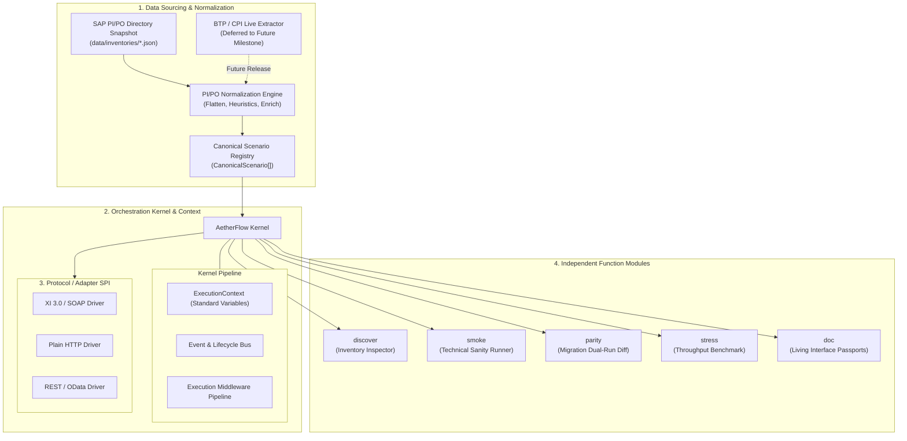
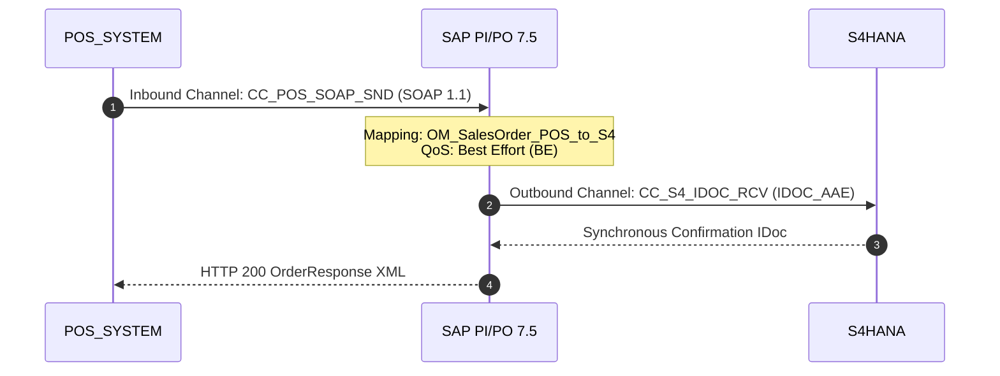

# Design Review: Modular Architecture & Dual-Purpose `CanonicalScenario`

> **Document Status:** `AWAITING USER REVIEW`  
> **Target Release:** AetherFlow Test Engine 1.1.0+  
> **Source Design Document:** [docs/ARCHITECTURE_AND_CANONICAL_SPEC.md](file:///home/cpc9181/dev/sap-integration-automated-testing/docs/ARCHITECTURE_AND_CANONICAL_SPEC.md)

---

## 1. Scope & Strategic Alignment

| Strategic Objective | Current Baseline State | Design Specification Target |
| :--- | :--- | :--- |
| **Data Baseline** | SAP PI/PO Directory extraction is already built in `sap-po-ico-reader` (extracting ICOs, channels, adapter attributes). | Ingest raw SAP PI/PO snapshots (`data/inventories/*.json`) and normalize into a standardized `CanonicalScenario`. |
| **BTP / CPI Ingestion** | Not currently implemented. | **Explicitly out of scope for the base version** and deferred to a future milestone as a standalone `@aetherflow/extractor-cpi` module. |
| **Dual-Purpose Model** | Ingestion only creates minimal `DiscoveredEndpoint` objects for URL query strings. | `CanonicalScenario` bridges **Automated Testing** (routing, QoS, validation, diff ignores) and **Living Developer Documentation** (Interface Passports, sequence diagrams, runbooks). |
| **Engine Architecture** | Tightly coupled CLI runners. | Hexagonal / Micro-Kernel: CLI functional modules (`discover`, `smoke`, `parity`, `stress`, `doc`) communicating via Kernel `ExecutionContext` and `ProtocolAdapter` SPI. |

---

## 2. Platform Architecture Diagram



---

## 3. Data Field Relevance Matrix (Extract $\rightarrow$ Testing & Documentation)

| Extracted SAP PI/PO Attribute | Relevant for Testing? | Relevant for Dev Documentation? | Why It Matters / How It's Used |
| :--- | :---: | :---: | :--- |
| **IntegratedConfigurationID** (`Sender`, `Receiver`, `Interface`, `Namespace`) | **CRITICAL** | **CRITICAL** | **Testing:** Exact routing keys for the `/XISOAPAdapter/MessageServlet` query string.<br>**Doc:** Primary identity tuple, unique identifier, and folder lineage. |
| **Quality of Service (QoS)** (`BE` vs `EO` vs `EOIO`) | **CRITICAL** | **CRITICAL** | **Testing:** Determines whether the test runner awaits a synchronous response body or polls the asynchronous monitoring servlet.<br>**Doc:** Documents the integration pattern (Real-Time API vs Async Event/Message). |
| **Serialization Queue Name** (`QueueName` for `EOIO`) | **HIGH** | **HIGH** | **Testing:** Essential for stress tests to monitor queue depth and avoid queue blocking.<br>**Doc:** Critical for Day-2 support to locate stuck queues in `SMQ1`/`SMQ2`/PIMON. |
| **Inbound Processing Channel** (`ChannelID`, `AdapterType`, `MessageProtocol`, `TransportProtocol`) | **HIGH** | **CRITICAL** | **Testing:** Selects the appropriate protocol driver and header generator (SOAP, XI 3.0, Plain HTTP).<br>**Doc:** Documents how source systems connect (SFTP, RFC, SOAP, REST, JDBC). |
| **Inbound Channel Specific Attributes** (Host, Port, Path, Directory, File Pattern) | **MEDIUM** | **CRITICAL** | **Testing:** Environmental verification and synthetic test payload naming.<br>**Doc:** Complete "As-Built" specification for external partners and network teams. |
| **Inbound Adapter Module Chain** (`ModuleProcessor` steps, module names, parameters) | **LOW** | **HIGH** | **Testing:** Informs payload structure if compression/decryption/conversion modules are active.<br>**Doc:** Explains custom Java modules, PGP decryption, FCC (Flat File Conversion), etc. |
| **Schema Validation Indicator** (`SchemaValidationIndicator = true/false`) | **CRITICAL** | **HIGH** | **Testing:** If enabled, invalid test payloads fail at the adapter engine before mapping. The test harness knows to enforce strict XML validation.<br>**Doc:** Explains strictness of ingress contract. |
| **Transformation / ESR Mapping** (`OperationMapping`, `SoftwareComponentVersion`, target interface) | **HIGH** | **CRITICAL** | **Testing:** Identifies expected response structures and target interface for dual-run parity.<br>**Doc:** Explains the core business logic, ESR objects, and mapping lineage. |
| **Outbound Processing Channel** (`ChannelID`, `AdapterType`, target endpoint/host) | **MEDIUM** | **CRITICAL** | **Testing:** Needed for dual-run parity target identification and backend dependency checks.<br>**Doc:** Complete routing destination specification (e.g., S/4HANA BAPI, Banking SFTP). |
| **Administrative Timestamps & Users** (`LastChangeDateTime`, `LastChangeUserAccountID`, `FolderPath`) | **LOW** | **CRITICAL** | **Testing:** CPA cache invalidation detection.<br>**Doc:** Historical audit trail, identifying the last engineer who configured the interface. |

---

## 4. Automatic Heuristics & Inferred Intelligence

To minimize manual developer effort, the normalization engine automatically derives metadata:

1. **Functional Domain:** Derived from `InterfaceNamespace` URI tokens:
   - `*Sales*`, `*SD*`, `*Order*` $\rightarrow$ **Logistics: Sales & Distribution (SD)**
   - `*Finance*`, `*FI*`, `*Payment*`, `*Tax*` $\rightarrow$ **Finance & Controlling (FI/CO)**
   - `*Procure*`, `*MM*`, `*Purchas*`, `*Vendor*` $\rightarrow$ **Procurement & Materials Management (MM)**
   - `*Warehouse*`, `*WMS*`, `*Inventory*` $\rightarrow$ **Supply Chain & Warehousing (SCM)**
   - `*HR*`, `*Employee*`, `*Payroll*` $\rightarrow$ **Human Resources (HCM)**
2. **Integration Architecture Pattern:** Derived from inbound channel protocol + QoS:
   - `SOAP` / `HTTP` / `REST` + `QoS == 'BE'` $\rightarrow$ **Synchronous Request/Reply API (`sync-request-reply`)**
   - `SOAP` / `XI` / `RFC` / `IDOC` + `QoS == 'EO' | 'EOIO'` $\rightarrow$ **Asynchronous Event/Message (`async-event-message`)**
   - `File` / `SFTP` + `QoS == 'EO'` $\rightarrow$ **Asynchronous Batch File Transfer (`async-batch-file`)**
   - `JDBC` $\rightarrow$ **Database Integration (`database-integration`)**
3. **Safety / Mutability Classification:**
   - Names containing `Get*`, `Read*`, `Query*`, `Fetch*`, `Status*`, `Search*` $\rightarrow$ **`read-only`** (Permits high-volume stress tests and automated sanity checks).
   - Names containing `Create*`, `Post*`, `Update*`, `Cancel*`, `Submit*`, `Process*` $\rightarrow$ **`state-mutating`** (Enforces safety guardrails to protect backend ERP systems from unintended postings).

---

## 5. Generated Interface Passport Sample (What `aetherflow doc` Produces)

````carousel
```markdown
# Interface Passport: SalesOrder_OB

> **Document Status:** Verified As-Built
> **Integration Pattern:** Synchronous Request/Reply API | **QoS:** BE
> **Functional Domain:** Logistics: Sales & Distribution (SD)
> **Safety Tier:** state-mutating

## 1. Executive Summary
* **Interface ID:** POS_SYSTEM_SalesOrder_OB_S4HANA
* **Interface Name:** SalesOrder_OB
* **Namespace:** http://company.com/xi/Sales
* **Sender Component:** POS_SYSTEM (Party: none)
* **Receiver Component:** S4HANA (Party: none)
* **Folder Lineage:** /SMRI_S4HANA_SD/POS_ORDERS/
* **Last Modified In SAP:** 2026-03-12 by user `cpc9181`
```
<!-- slide -->

<!-- slide -->
```markdown
## 2. Ingress & Test Execution Specification
* **Target Runtime Path:** `/XISOAPAdapter/MessageServlet?senderService=POS_SYSTEM&interface=SalesOrder_OB&interfaceNamespace=http%3A%2F%2Fcompany.com%2Fxi%2FSales&qos=BE`
* **HTTP Method:** `POST`
* **Content-Type:** `application/xml`
* **Schema Validation:** Enforced (`SchemaValidationIndicator = true`)

### Quick cURL Test Command
```bash
curl -X POST "https://sap-qa:50001/XISOAPAdapter/MessageServlet?senderService=POS_SYSTEM&interface=SalesOrder_OB&interfaceNamespace=http%3A%2F%2Fcompany.com%2Fxi%2FSales&qos=BE" \
  -u "PI_TEST_USER:SecretPassword" \
  -H "Content-Type: application/xml" \
  --data-binary @payloads/SalesOrder_OB/test-01.xml
```
```
<!-- slide -->
```markdown
## 3. Day-2 Operational Runbook
* **Primary Monitoring Tool:** PIMON -> Message Monitoring -> Filter Component `POS_SYSTEM`
* **Restart Permitted in PIMON:** Caution (state-mutating; check for duplicate POS order number before manual restart).
* **Failing Step Diagnostic:**
  - Inbound SOAP Fault: Invalid payload structure / XML schema rejection.
  - Mapping Step Error: Required field missing in POS transaction XML.
  - Outbound Adapter Call: RFC/IDoc connection failure to S/4HANA.
```
````

---

## 6. Implementation Rollout Plan

1. **Step 1:** Create `src/types/scenario.ts` defining `CanonicalScenario`, `QualityOfService`, `ScenarioSafetyTier`, and `IntegrationPattern`.
2. **Step 2:** Build `src/discovery/pipo-normalizer.ts` transforming raw `IcoRecord` & `ChannelRecord` objects from inventory JSON into clean `CanonicalScenario[]`.
3. **Step 3:** Scaffold the Kernel `ExecutionContext` and `ProtocolAdapter` SPI.
4. **Step 4:** Build the Living Documentation Generator (`src/reporter/passport-generator.ts` and `aetherflow doc` CLI command).
5. **Step 5:** Connect `smoke`, `parity`, and `stress` modules to consume `CanonicalScenario`.
