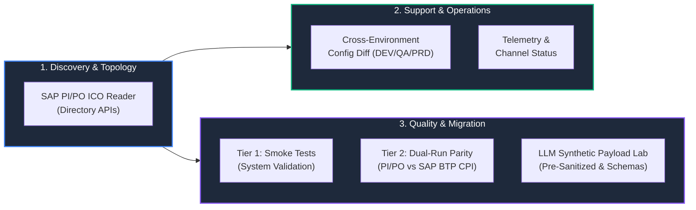
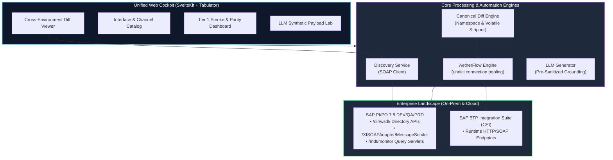
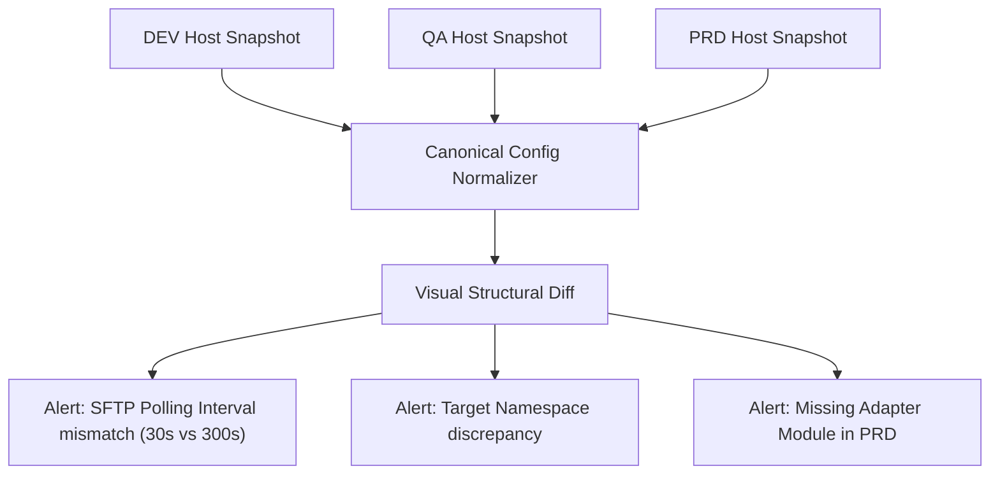
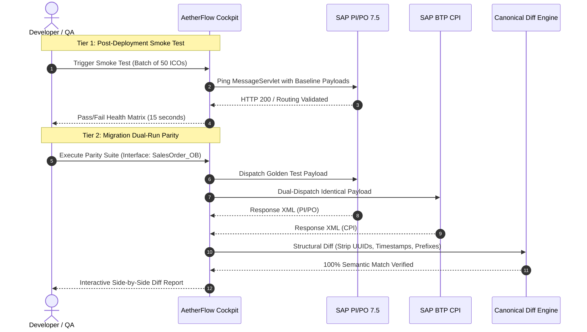
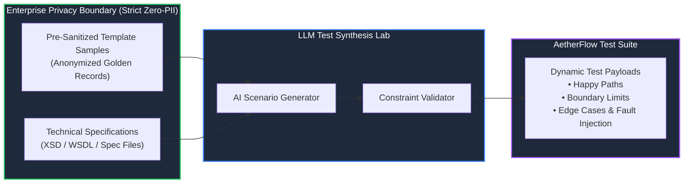
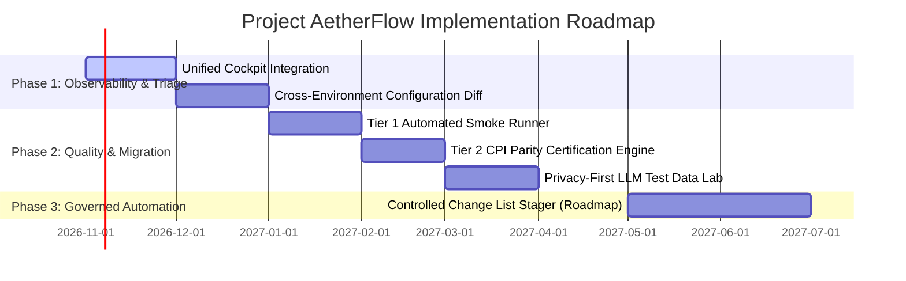

# Project AetherFlow: Next-Generation Integration Acceleration & Migration Platform

**Executive Presentation Deck & Business Case**  
*Tailored for Executive & IT Management*

---

## Executive Overview



> [!IMPORTANT]
> **Core Value Thesis:** By synthesizing our existing internal tools ([`sap-po-ico-reader`](file:///home/cpc9181/dev/sap-po-ico-reader/README.md), [`sap-integration-automated-testing`](file:///home/cpc9181/dev/sap-integration-automated-testing/README.md), and [`integration-daily-report`](file:///home/cpc9181/dev/integration-daily-report/PLAN.md)) into a single **Unified Integration Cockpit**, we eliminate the need for expensive third-party testing suites ($150k–$300k+), de-risk the mandatory **SAP BTP Cloud Integration (CPI) migration**, slash support MTTR by 60%, and introduce an enterprise-compliant, privacy-first AI test generation engine.

---

## Slide 1: Strategic Context & Urgency

### Why Now? The Dual Pressure on Enterprise Integration

1. **The 2027/2030 SAP NetWeaver 7.5 End-of-Life Horizon:**
   - SAP PI/PO 7.5 mainstream maintenance concludes by 2027 (extended to 2030 at premium support costs).
   - Enterprise IT must migrate hundreds of critical interfaces from on-premise PI/PO to **SAP Integration Suite (BTP Cloud Integration / CPI)**.
   - The primary bottleneck and cost driver in every migration project is **manual regression testing** and interface verification.

2. **Escalating Operational Friction:**
   - Daily production incidents require Level 2/3 support to manually piece together logs across siloed SAP tools (PIMON, NetWeaver Developer Studio, SAP GUI).
   - "It worked in DEV but failed in QA/PRD" issues take hours of manual parameter-by-parameter inspection to isolate configuration drift.

3. **High Third-Party Licensing Costs:**
   - Commercial SAP testing platforms (e.g., Int4 IFTT, Tricentis Tosca) charge steep annual subscriptions ($150k–$300k+) and require lengthy implementation cycles.

---

## Slide 2: The Critical Value Gap — What SAP PI/PO 7.5 Lacks

To justify internal tool development, we strictly address **unmet enterprise capabilities** that native SAP tools cannot deliver:

| Operational Dimension | Native SAP PI/PO 7.5 Capability | Pain Point / Limitation | Project AetherFlow Solution |
| :--- | :--- | :--- | :--- |
| **Regression Testing** | Single-message manual testing inside ESR Test Tab | No automated batch testing; no test suite management; zero automation | **Automated Test Harness** executing regression suites across 100+ interfaces in minutes |
| **Migration Certification** | None; manual comparison of message payloads | Testing PI/PO vs CPI requires manual message triggering and eyeballing logs | **Dual-Run Parity Engine** with automated canonical XML/JSON structural diffing |
| **Configuration Audit** | Single-object view in NWDS / Swing Integration Directory | Impossible to visually compare DEV vs QA vs PRD configurations | **Cross-Environment Diffing** highlighting parameter drift in seconds (100% PII-free) |
| **Test Data Creation** | Manual payload editing in Notepad/XML editors | Requesting production XMLs introduces severe PII/compliance risks | **LLM Synthetic Payload Lab** conditioned exclusively on pre-sanitized templates & XSDs |
| **Support Triage** | PIMON shows flat list of sequential message errors | Support must manually correlate errors; channel diagnostics are isolated | **Contextual Interface View** uniting routing rules, channel health, and fast smoke tests |

---

## Slide 3: Unified Platform Architecture

Project AetherFlow unifies the existing internal repositories into a coherent three-tier platform:



### Component Roles & Reuse of Existing Assets:
1. **Frontend:** Extends [`sap-po-ico-reader`](file:///home/cpc9181/dev/sap-po-ico-reader/README.md) into the unified single-pane-of-glass UI.
2. **Execution Engine:** Integrates [`sap-integration-automated-testing`](file:///home/cpc9181/dev/sap-integration-automated-testing/README.md) (AetherFlow) as the background test runner.
3. **Telemetry & Monitoring:** Ingests operational endpoints from [`integration-daily-report`](file:///home/cpc9181/dev/integration-daily-report/PLAN.md) for channel health and message overview.

---

## Slide 4: Pillar 1 — Cross-Environment Configuration Diffing

### Eliminating the #1 Cause of Deployment Defects

A frequent source of critical incidents during releases is **configuration drift**: an adapter module parameter, URL, timeout, or QoS setting was modified in DEV or QA but omitted or mistyped in PRD.



### Strategic Benefits for Support & Operations:
- **Instant Root Cause Isolation:** Reduces time spent isolating environment drift from hours to under 30 seconds.
- **Pre-Flight Release Validation:** Compare QA against PRD *before* cutover to verify that all transport objects match expected configurations.
- **Zero Privacy & Compliance Overhead:** Operates strictly on technical configuration metadata (URLs, channels, rules)—**zero transaction data or PII is ever accessed**.

---

## Slide 5: Pillar 2 — Tiered Testing & Migration Parity



### Two Distinct Testing Tiers:

1. **Tier 1: High-Speed Technical Smoke Testing (`smoke`):**
   - Dispatches lightweight baseline calls to `/XISOAPAdapter/MessageServlet` across hundreds of interfaces.
   - Verifies channel readiness, CPA cache integrity, authentication, and receiver determination in seconds following kernel patches or server reboots.

2. **Tier 2: Dual-Run Migration Parity (`parity`):**
   - Dispatches identical test payloads simultaneously to SAP PI/PO 7.5 and SAP BTP CPI.
   - **Canonical XML/JSON Diffing:** Automatically strips volatile fields (UUIDs, timestamps, session tokens) and ignores namespace prefix differences (`ns0:` vs `p:`).
   - Generates automated certification reports proving 100% equivalence before cutting over production traffic.

---

## Slide 6: Pillar 3 — Privacy-First LLM Synthetic Test Data Lab

### Solving the Test Data Bottleneck Without Compliance Risk

Traditional test generation either produces random "garbage" data that fails ERP business validations, or requires copying production data (which violates GDPR, HIPAA, and corporate data governance policies).

> [!CAUTION]
> **Enterprise Data Privacy Policy (Zero-PII Architecture):**  
> To protect enterprise data and eliminate InfoSec friction, **no raw production messages, database records, or unverified payloads will ever be fed into an LLM.**



### How the LLM Generator Operates:
- **Input:** Takes only pre-sanitized, generic template samples or official interface schemas (XSD/WSDL).
- **Intelligent Variation:** Generates variations that adhere to real business logic (e.g. realistic order line items, valid country/currency codes, boundary dates, missing optional segments, extreme quantities).
- **Macro Injection:** Automatically inserts dynamic execution tokens (e.g., `{{$guid}}`, `{{$isoTimestamp}}`, `{{$randomInt}}`) compatible with the AetherFlow runtime engine.

---

## Slide 7: The NWDS Question & Strategic Roadmap

### Understanding the NetWeaver Developer Studio (NWDS) Architecture

> [!NOTE]
> **Technical Finding:** Direct modification of Integration Directory (ID) objects was **never exclusive to NWDS**.  
> NWDS is an Eclipse-based client that calls standard SAP PI/PO J2EE SOAP Web Services (`CommunicationChannelInService`, `IntegratedConfigurationInService`, `ChangeListInService`).  
> Any authorized tool can execute CRUD operations, stage changes, and manage Change Lists programmatically.

### Phased Roadmap (Balancing Safety and Automation)



- **Phase 1 (Immediate / Safe Non-Invasive):** Deploy Unified Cockpit with multi-host discovery and Cross-Environment Config Diffing (zero change risk, immediate MTTR reduction).
- **Phase 2 (Migration & Quality):** Tier 1 smoke tests, Tier 2 PI-to-CPI parity certification, and LLM synthetic payload generation.
- **Phase 3 (Future Roadmap — Governed Bulk Automation):** Safe bulk updates (e.g. mass certificate rotation, host migrations) staged directly into standard SAP Change Lists for manual review and CTS transport.

---

## Slide 8: Enterprise Security, Governance & Safety

The platform is designed around strict enterprise security invariants:

1. **Non-Production Safety Fence:**  
   - Built-in URL/hostname inspection intercepts and rejects any execution against production systems (`*prd*`, `*prod*`, `SPP*`) unless explicitly confirmed with overrides.
2. **Zero Credential Persistence:**  
   - All SAP user credentials and bearer tokens are masked in logs, memory, and reports.
3. **Native Role-Based Authorization:**  
   - Uses standard SAP J2EE roles (`SAP_XI_MONITOR_J2EE`, `XIIntegrationDeveloper`). No backdoor database access or unauthenticated endpoints.
4. **Local Network Boundary:**  
   - Runs locally or within the corporate intranet behind reverse proxy/VPN controls (binding to `127.0.0.1` by default).

---

## Slide 9: Business Case & Return on Investment (ROI)

### Quantitative Financial & Operational Impact

```text
+---------------------------------------------------------------------------------+
| Metric                              Traditional Approach     With AetherFlow    |
+---------------------------------------------------------------------------------+
| Third-Party Test Tool Licensing     $150,000 - $350,000/yr   $0 (Internal IP)   |
| Regression Testing (per wave)       80 - 120 person-hours    4 - 8 person-hours |
| CPI Migration Certification Speed   3 - 5 days / interface   30 mins / interface|
| Support MTTR (Config Incidents)     2 - 4 hours              15 - 30 minutes    |
| PII Violation / InfoSec Risk        High (manual XML dumps)  Zero (Privacy-first)|
+---------------------------------------------------------------------------------+
```

### Strategic Value Drivers:
- **Direct CapEx/OpEx Avoidance:** Saves six figures annually in commercial software licenses.
- **De-risking the SAP 2027/2030 Deadline:** Accelerates BTP Cloud Integration migration velocity by 4x to 6x.
- **Developer & Support Productivity:** Eliminates repetitive, manual XML authoring and log scraping, allowing senior engineers to focus on high-value development.

---

## Slide 10: Executive Decision & Next Steps

### Recommended Actions:

1. **Approve Phase 1 Pilot Demonstration:**  
   - Deploy the Unified Cockpit with the **Cross-Environment Configuration Diff** and **Tier 1 Smoke Testing** across DEV and QA environments.
2. **Authorize Privacy-Safe LLM Test Lab POC:**  
   - Test LLM synthetic generation against 3 representative enterprise interfaces using sanitized templates and XSDs.
3. **Review Steering Committee Milestone:**  
   - Schedule a 30-day follow-up demonstrating live dual-run parity testing between SAP PI/PO and an SAP BTP CPI target tenant.
