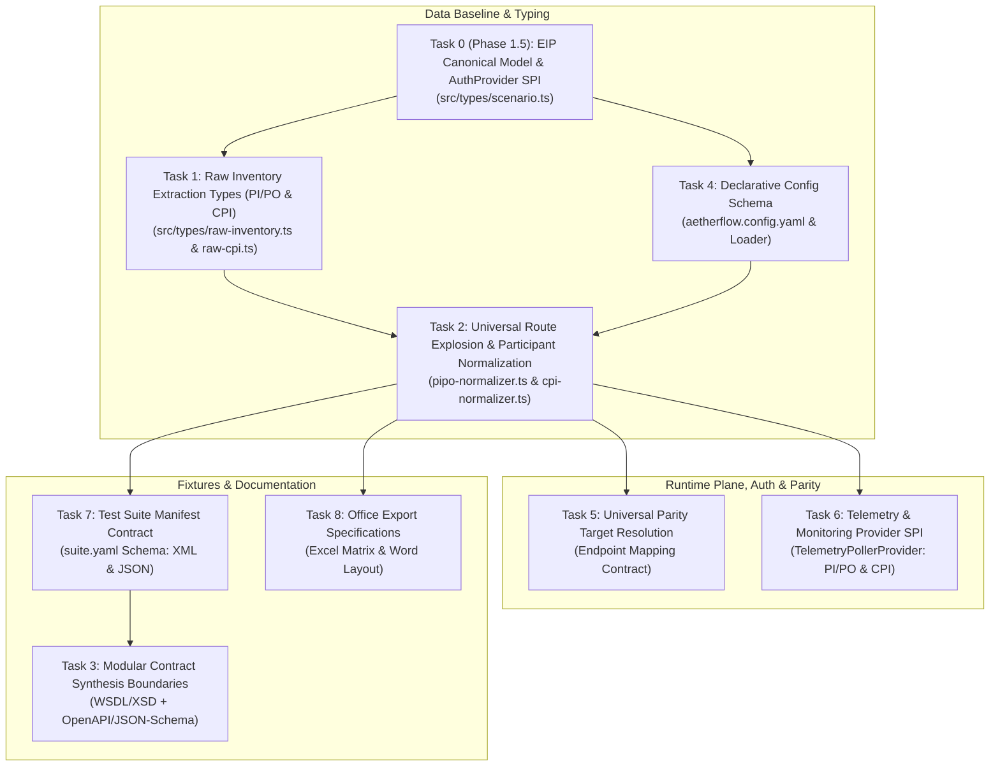

# Detailed Technical Task List: Under-Defined Architectural Components

> **Target Version:** AetherFlow Test Engine 1.1.0+  
> **Status:** `ALIGNED ARCHITECTURAL TASK LIST (PI/PO & BTP CPI UNIFIED)`  
> **Authoritative Context:** Implements foundational specifications required prior to completing functional normalizers, generators, and test runners in [`docs/ARCHITECTURE_AND_CANONICAL_SPEC.md`](file:///home/cpc9181/dev/sap-integration-automated-testing/docs/ARCHITECTURE_AND_CANONICAL_SPEC.md).

---

## Executive Summary & Dependency Graph

To prevent platform bias and eliminate developer guesswork, nine core architectural contracts, data baselines, and provider SPIs have been defined. This task list incorporates the architectural alignment reached during our `/grill-me` session: ensuring `CanonicalScenario` and all supporting subsystems natively support both **SAP NetWeaver PI/PO** and **SAP BTP Integration Suite (CPI)** using Enterprise Integration Patterns (EIP) without vendor lock-in.



---

## Task 0 (Phase 1.5): Platform-Neutral EIP Canonical Model & AuthProvider SPI

* **Status:** `READY FOR IMPLEMENTATION` (Unblocks Tasks 1, 2, 5, 6)
* **Target Files:**
  * `src/types/scenario.ts`
  * `src/types/scenario.test.ts`

### 1. What We Need
Refactor `CanonicalScenario` in `src/types/scenario.ts` to replace NetWeaver-specific terminology with universal Enterprise Integration Patterns (EIP):
1. **Decouple `icoId` at Root:** Remove mandatory top-level `icoId`. Provenance is captured cleanly in `lineage`:
   ```typescript
   lineage: {
     ecosystem: PlatformEcosystem;           // 'sap-pipo' | 'sap-cpi' | 'generic-http'
     sourceArtifactType: 'ICO' | 'iFlow' | 'InterfaceDetermination' | string;
     sourceArtifactId: string;               // ICO GUID, iFlow ID, or technical artifact ID
     sourceContainer?: string;               // PI/PO Folder path or BTP CPI Package ID
     version?: string;                       // Artifact version or revision timestamp
     sourceInventoryId?: string;             // Inventory snapshot UUID
   };
   ```
2. **Platform-Neutral Runtime Endpoint & Auth:**
   * Rename `servletPath` to `path` (relative path like `/XISOAPAdapter/...` or `/http/orders`).
   * Add declarative `auth?: { type: 'basic' | 'oauth2' | 'client-cert' | 'none'; csrfProtection?: boolean }`.
3. **EIP Adapters & Pipelines:**
   * Rename `inboundChannel` / `outboundChannel` to `inboundAdapter` / `outboundAdapter`.
   * Standardize properties: `name`, `adapterType`, `transport`, `protocol`, `attributes`, and `pipeline` (Java module chain or Camel steps: Groovy, XSLT, Content Modifier).
4. **Contract & Schema Specification:**
   * Replace SOAP-only `schema` with `contract?: { format: ContractFormat; url?: string; filePath?: string; rootEntity?: string; targetNamespace?: string }`.
   * `ContractFormat = 'wsdl' | 'xsd' | 'openapi' | 'json-schema' | 'edmx' | 'opaque'`.
5. **Universal Parity:**
   * Replace `cpiEndpointPath` with `targetEcosystem`, `targetPath`, `targetScenarioId`, and `httpMethod`.
6. **AuthProvider SPI:**
   ```typescript
   export interface AuthProvider {
     readonly id: string;
     readonly ecosystem: PlatformEcosystem;
     buildAuthHeaders(hostConfig: HostConfig, context?: ExecutionContext): Promise<Record<string, string>>;
     preFlightHandshake?(hostConfig: HostConfig, endpointPath: string): Promise<Record<string, string>>;
   }
   ```
7. **Strict Backward Compatibility:**
   * Update `scenarioToDiscoveredEndpoint()` so that all legacy v1.0 runners and 118 tests continue to pass with 0 regressions.

---

## Task 1: Formal Raw Inventory Extraction Type Definitions

* **Status:** `PARTIALLY COMPLETED` (PI/PO completed; CPI raw artifact contract pending)
* **Target Files:**
  * `src/types/raw-inventory.ts` (`COMPLETED` with unit tests)
  * `src/types/raw-cpi.ts` (`PENDING`)

### 1. What We Need
1. **PI/PO (`src/types/raw-inventory.ts` - DONE):**
   * Strict TypeScript interfaces matching `sap-po-ico-reader` exports: `RawIntegratedConfiguration`, `RawCommunicationChannel`, `RawAdministrativeData`, `RawReceiverRule`, etc.
   * Resilient array utility `toArray<T>(item)` handling XML-to-JSON single-child deserialization quirks.
2. **BTP CPI (`src/types/raw-cpi.ts` - PENDING):**
   * Strict TypeScript interfaces matching exported BTP CPI iFlow bundles / metadata snapshots:
     ```typescript
     export interface RawCpiArtifact {
       Id: string;                           // iFlow ID (e.g. "Process_Sales_Orders")
       Name: string;                         // Display name
       PackageId: string;                    // Parent package ID
       Version: string;                      // Semantic version (e.g. "1.0.4")
       Description?: string;
       SenderChannels?: Array<{
         Name: string;
         AdapterType: string;                // "HTTPS", "SOAP", "ProcessDirect", etc.
         TransportProtocol: string;
         MessageProtocol: string;
         EndpointAddress: string;            // e.g. "/http/v2/orders"
         Parameters: Record<string, any>;
       }>;
       ReceiverChannels?: Array<{
         Name: string;
         AdapterType: string;
         EndpointAddress?: string;
         Parameters: Record<string, any>;
       }>;
       Participants?: Array<{
         Role: 'Sender' | 'Receiver';
         Name: string;                       // e.g. "Shopify", "SAP_S4HANA"
       }>;
     }
     ```

---

## Task 2: Universal Route Explosion & Participant Normalization

* **Status:** `PENDING IMPLEMENTATION`
* **Target Files:**
  * `src/discovery/pipo-normalizer.ts` (`built-in:normalizer:sap-pipo`)
  * `src/discovery/cpi-normalizer.ts` (`built-in:normalizer:sap-cpi`)
  * `src/config/heuristics.ts`
  * `src/discovery/pipo-normalizer.test.ts`, `src/discovery/cpi-normalizer.test.ts`

### 1. What We Need
Formalize the normalization engines that convert raw snapshots into `CanonicalScenario[]`:

1. **PI/PO Multi-Receiver Route Explosion (`pipo-normalizer.ts`):**
   * Iterate over all `RawReceiverInterface` entries in `toArray(ico.ReceiverInterfaces)`.
   * Correlate receiver with `RawOutboundProcessing` configuration (`Receiver.ComponentID`, `Receiver.PartyID`, `ReceiverInterface.Name`).
   * Dereference communication channels from `inventory.communicationChannels` for inbound and outbound.
   * Generate deterministic ID:
     ```typescript
     const baseId = `${sender}_${interfaceName}_${receiver}`;
     const id = totalRoutes > 1 ? `${baseId}_route${routeIndex}` : baseId;
     ```
   * Populate `lineage.sourceArtifactType = 'ICO'`, `lineage.sourceArtifactId = ico.id`, `lineage.sourceContainer = folderPath.join('/')`.
2. **CPI Participant & Route Extraction (`cpi-normalizer.ts`):**
   * Iterate over sender channels in `rawCpiArtifact.SenderChannels`.
   * Match corresponding receiver channels and BPMN participants.
   * If participants are missing, default sender to `EXTERNAL` and receiver to `BACKEND`.
   * Generate deterministic ID: `${sender}_${artifact.Id}_${receiver}`.
   * Populate `lineage.sourceArtifactType = 'iFlow'`, `lineage.sourceArtifactId = artifact.Id`, `lineage.sourceContainer = artifact.PackageId`.
3. **Universal Heuristics Engine (`heuristics.ts`):**
   * **Domain Inference:** `SD` (Sales/Order), `FI/CO` (Finance/Tax/Payment), `MM` (Procure/Purchas/Vendor), `SCM` (Warehouse/WMS), `HCM` (HR/Employee/Payroll).
   * **Integration Pattern:** `sync-request-reply` (SOAP/HTTP + BE), `async-event-message` (SOAP/XI/JMS + EO), `async-batch-file` (File/SFTP + EO), `database-integration` (JDBC).
   * **Safety Tier:** `read-only` (`Get*`, `Read*`, `Query*`, `Fetch*`, `Search*`), `state-mutating` (`Create*`, `Post*`, `Update*`, `Cancel*`), `unknown` (all others).
4. **Config Rule Precedence:**
   $$\text{CLI Flags} > \text{Scenario Overrides} > \text{Heuristic Rules} > \text{Built-in Defaults}$$

---

## Task 3: Modular Contract Synthesis Boundary Conditions (`generate`)

* **Status:** `PENDING IMPLEMENTATION`
* **Target Files:**
  * `src/generator/testcase-generator.ts` (Master generator provider dispatcher)
  * `src/generator/generators/wsdl-generator.ts` (WSDL/XSD for SOAP / PI/PO)
  * `src/generator/generators/openapi-generator.ts` (OpenAPI/JSON for REST / CPI)
  * `src/generator/xsd-synthesizer.ts`

### 1. What We Need
Formalize contract analysis, schema fetching, and recursive synthesis boundaries:
1. **Contract Resolution:**
   * Dynamic fetch: `/dir/wsdl?p=sa/...` for PI/PO; `/http/.../$openapi` or cached schema for CPI.
   * Local schema fallback: `./schemas/<scenarioId>.*` $\rightarrow$ `./schemas/<InterfaceName>.*`.
2. **Schema AST Synthesis Boundaries (Universal Invariants):**
   * **Recursion Depth Cap:** Maximum nesting depth of `5`. Circular references terminate with empty elements or primitive fallbacks.
   * **Multiplicity Cap:** For `maxOccurs="unbounded"` or arrays, synthesize exactly **2 distinct items** with unique keys (e.g. `Item 001`, `Item 002`) to verify iteration without bloating payload size.
   * **Primitive Synthesizers:**
     * Strings: Respect `minLength` and `maxLength` (default 12 chars).
     * Numbers: Midpoint between `minInclusive` and `maxInclusive`.
     * Dates: ISO UTC timestamp (`YYYY-MM-DD` / `YYYY-MM-DDTHH:mm:ssZ`).
     * Enums: First valid enum for happy path; `INVALID_ENUM_VALUE` for negative test.
3. **Negative Test Generation (`02-negative-missing-mandatory.*`):**
   * Omit the first mandatory element (`minOccurs >= 1` or JSON `required` field) to assert that the runtime adapter engine rejects invalid input before reaching ERP backend databases.

---

## Task 4: Declarative Configuration Schema (`aetherflow.config.yaml`)

* **Status:** `COMPLETED` (Loader & tests passing; verify platform-neutral alias support)
* **Target Files:**
  * `src/config/aetherflow-config.ts`
  * `src/config/aetherflow-config.test.ts`

### 1. What We Need
* Load and parse `aetherflow.config.yaml` / `.aetherflow.yaml`.
* Provide regex-based `heuristics.domainRules`, `heuristics.safetyRules`, and `heuristics.patternRules`.
* Provide `parity.targetEndpointPattern` (with backward-compatible support for `parity.cpiEndpointPattern`).
* Provide `scenarios[<scenarioId>]` overrides for `safetyTier`, `timeoutMs`, `targetPath`, and `volatileFieldIgnores`.

---

## Task 5: Universal Dual-Run Parity Target Resolution & Mapping Contract

* **Status:** `PENDING IMPLEMENTATION`
* **Target Files:**
  * `src/engine/parity-runner.ts`
  * `src/engine/parity-runner.test.ts`

### 1. What We Need
Formalize how `CanonicalScenario` resolves the migration target endpoint during dual-run parity testing across any two platforms (e.g. PI/PO $\rightarrow$ CPI):

```typescript
export interface ParityTargetConfig {
  targetEcosystem: PlatformEcosystem;     // e.g. 'sap-cpi'
  targetPath?: string;                    // Explicit relative path (e.g. "/http/v2/SalesOrders")
  targetScenarioId?: string;              // Direct link to counterpart CanonicalScenario
  httpMethod?: 'POST' | 'GET';
}
```

**Dynamic Target Resolution Algorithm:**
1. **Step 1 (Exact Config Override):** Check `aetherflow.config.yaml` under `parity.targetEndpointOverrides[scenario.id]` (or `parity.cpiEndpointOverrides`).
2. **Step 2 (Scenario Manifest):** Check `scenario.parity.targetPath`.
3. **Step 3 (Pattern Rule):** Evaluate `parity.targetEndpointPattern` template (default: `"/http/{sender}/{interfaceName}"`), resolving `{sender}`, `{interfaceName}`, and `{receiver}` tokens.
4. **Step 4 (CLI Flag):** Use `--target-path` if explicitly provided on the command line.

---

## Task 6: Telemetry & Monitoring Provider SPI (`TelemetryPollerProvider`)

* **Status:** `SPI DEFINED; PROVIDERS PENDING`
* **Target Files:**
  * `src/types/scenario.ts` (`TelemetryPollerProvider` SPI defined)
  * `src/verifier/providers/pipo-poller.ts` (`built-in:poller:pipo-message-monitoring`)
  * `src/verifier/providers/cpi-poller.ts` (`built-in:poller:cpi-mpl-monitoring`)
  * `src/verifier/async-poller.ts` (Preserves legacy v1.0 export)

### 1. What We Need
Standardize asynchronous telemetry monitoring across platforms:
* **PI/PO Provider:** Wraps SOAP `AdapterMessageMonitoringVi` to query status (`DELIVERED`, `WAITING`, `SYSTEM_ERROR`).
* **BTP CPI Provider:** Queries OData API `/api/v1/MessageProcessingLogs('<messageId>')` to query status (`COMPLETED`, `FAILED`, `PROCESSING`).
* Registered in `EcosystemRegistry` so test runners poll asynchronously without platform-specific `if/else` logic.

---

## Task 7: Test Suite Manifest Contract (`suite.yaml`)

* **Status:** `COMPLETED` (Types defined in `src/types/suite.ts`)
* **Target Files:**
  * `src/types/suite.ts`

### 1. What We Need
Formalize the schema of `fixtures/<scenarioId>/suite.yaml`:
* `TestSuiteManifest`: declares `scenarioId`, `ecosystem`, `schemaSource`, `testCases: TestCaseDescriptor[]`, and `volatileFieldIgnores: string[]`.
* `TestCaseDescriptor`: declares `id`, `file` (supports `.xml` or `.json`), `type` (`positive` | `negative` | `boundary`), `expectedStatusCode` (e.g. 500 for negative test), and `expectedIsFault`.
* Fallback: If `suite.yaml` is absent, test runners assume standard positive test (`expectedStatusCode: 200`, `expectedIsFault: false`).

---

## Task 8: Office Export Specifications (Excel Matrix `.xlsx` & Word `.docx`)

* **Status:** `PENDING IMPLEMENTATION`
* **Target Files:**
  * `src/reporter/formats/excel-matrix.ts`
  * `src/reporter/formats/word-specification.ts`
  * `src/reporter/passport-generator.ts`

### 1. What We Need
Formulate exact layout and styling specifications for SharePoint-ready deliverables:

#### A. Master Excel Matrix Specification (`.xlsx` via `exceljs`)
* **Sheet 1: `Master Inventory`**
  * Columns: `Scenario ID`, `Lineage (Artifact ID)`, `Ecosystem`, `Functional Domain`, `Interface / iFlow Name`, `Sender System`, `Inbound Adapter`, `Receiver System`, `Outbound Adapter`, `QoS`, `Safety Tier`, `Integration Pattern`, `Last Changed Date`, `Last Changed User`.
  * Navy Corporate Header (`#1A365D`), bold white text, row height `28pt`.
  * Auto-filter on all columns, frozen header row (`freezePanes: { row: 1 }`).
  * Conditional color formatting on Safety Tier: Soft Green (`#C6F6D5`) for `read-only`, Soft Amber (`#FEEBC8`) for `unknown`, Soft Red (`#FED7D7`) for `state-mutating`.
* **Sheets 2–N: Domain Tabs** (`SD`, `FI-CO`, `MM`, `SCM`, `HCM`).

#### B. Individual Word Interface Specification (`.docx` via `docx`)
* Sections:
  1. Cover & Executive Summary (Interface Name, Domain, Safety Tier badge, Last Change timestamp).
  2. Technical As-Built Specification (Inbound/Outbound adapters, protocols, pipelines, transformation).
  3. Runtime Dispatch & cURL snippet.
  4. Operational Runbook (Monitoring search attributes, escalation paths, retry rules).
  5. Formal Enterprise Sign-Off Table (`Role`, `Name`, `Signature`, `Date`, `Status`).

---

## Master Recommended Execution Order

| Step | Task ID | Deliverable | Pre-requisites | Status |
| :---: | :--- | :--- | :--- | :---: |
| **0** | **Task 0 (Phase 1.5)** | `src/types/scenario.ts` (EIP Canonical & Auth SPI) | Phase 1 Registry | **Completed** |
| **1** | **Task 1** | `src/types/raw-cpi.ts` (CPI raw artifact types) | Task 0 | **Completed** |
| **2** | **Task 4** | Verify `aetherflow.config.yaml` target pattern aliases | Task 0 | **Completed** |
| **3** | **Task 2** | `src/discovery/pipo-normalizer.ts` & `cpi-normalizer.ts` | Tasks 0, 1, 4 | **Completed** |
| **4** | **Task 5** | Parity target resolution algorithm in runner | Task 2 | **Ready** |
| **5** | **Task 6** | `TelemetryPollerProvider` PI/PO & CPI implementations | Task 2 | **Ready** |
| **6** | **Task 7** | Verify `suite.yaml` parser & runner integration | Task 2 | **Ready** |
| **7** | **Task 3** | WSDL/OpenAPI synthesis rules in `src/generator/` | Tasks 2, 7 | Blocked by 7 |
| **8** | **Task 8** | Excel & Word Office generators in `src/reporter/` | Task 2 | **Ready** |
