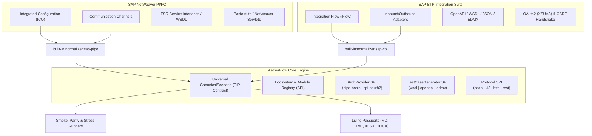

# Unified Canonical Integration Architecture: PI/PO & BTP CPI Alignment

> **Status:** ALIGNED & FORMALIZED  
> **Session:** Architecture Design Review (`/grill-me`)  
> **Core Objective:** Design a truly universal, platform-neutral `CanonicalScenario` and modular ecosystem SPI that natively accommodates both **SAP NetWeaver PI/PO** and **SAP BTP Integration Suite (Cloud Integration / CPI)** without retrofitting or platform bias.

---

## 1. Executive Summary & Core Architectural Principle

During the roadmap review, we identified that modeling the `CanonicalScenario` primarily around SAP PI/PO Integrated Configurations (ICOs) would introduce platform bias and structural technical debt, forcing breaking schema migrations once SAP BTP CPI is integrated.

### The Universal Invariant
> **The Canonical Scenario must speak the language of Enterprise Integration Patterns (EIP), never vendor- or platform-specific terminology.** Platform-specific eccentricities (NetWeaver servlets, ICO GUIDs, BTP iFlow packages, XSUAA tokens, Camel routes) belong strictly inside **Ecosystem Normalizers** and **Modular SPI Providers**, never on the Canonical Model.



---

## 2. The 7 Architectural Pillars (Formalized Decisions)

### Pillar 1: Platform-Neutral Identity & Lineage
* **Removal of `icoId` at Root:** Top-level `icoId` is retired. Scenario identity is cleanly divided into a runtime testing key (`id`) and an immutable provenance record (`lineage`).
* **Universal Lineage:** `lineage` captures the originating artifact, its ecosystem sphere, container/package hierarchy, and version:
  * **For PI/PO:** `artifactType = 'ICO'`, `artifactId = <icoGuid>`, `container = <directoryFolderPath>`, `version = <lastChangeTimestamp>`.
  * **For BTP CPI:** `artifactType = 'iFlow'`, `artifactId = <iFlowId>`, `container = <packageId>`, `version = <bundleVersion>`.
* **Deterministic ID Formulation:**
  * Standard: `${sender}_${interfaceName}_${receiver}`
  * Multi-route / Branch: `${sender}_${interfaceName}_${receiver}_route${routeIndex}`

### Pillar 2: Modular Ecosystem AuthProvider SPI
* **Decoupled Auth Handshake:** `CanonicalScenario` remains purely declarative, stating *what* security protocol is expected (`auth: { type: 'oauth2' | 'basic' | 'client-cert' | 'none', csrfProtection?: boolean }`), never *how* to negotiate it.
* **Ecosystem-Bound Auth Handlers:**
  * `auth:sap-pipo-basic`: Evaluates credentials from `HostConfig` and dispatches standard HTTP Basic Auth headers.
  * `auth:sap-cpi-oauth2`: Manages automated BTP XSUAA token retrieval (`POST /oauth/token`), in-memory token TTL caching, and pre-flight CSRF token/cookie handshakes (`HEAD`/`GET` with `X-CSRF-Token: Fetch`).

### Pillar 3: Dual-Layer Interaction Semantics (EIP Patterns + Execution QoS)
* **High-Level Architectural Abstraction:** `integrationPattern` defines the pattern:
  * `sync-request-reply`
  * `async-event-message`
  * `async-batch-file`
  * `database-integration`
* **Low-Level Execution Semantics:** `routing.qos` provides the execution engine with strict dispatch instructions:
  * `BE` (Best Effort): Engine awaits synchronous HTTP 200/500 business response payload.
  * `EO` (Exactly Once): Engine expects HTTP 200/202 ack, extracts message identifier, and triggers the ecosystem's registered `TelemetryPollerProvider`.
  * `EOIO` (Exactly Once In Order): Engine tracks queue serialization (`queueName`).

### Pillar 4: Platform-Neutral Routing & Participants
* **Terminology Alignment:** Eliminate "Component" (SAP PI/PO NetWeaver specific). Use `sender` and `receiver` (or `senderSystem` and `receiverSystem`).
* **Normalization Logic:**
  * In PI/PO: Mapped from `SenderComponentID` and `ReceiverComponentID`.
  * In CPI: Mapped from BPMN Participant definitions, falling back to configured adapter partner endpoints, or defaulting gracefully to `EXTERNAL` / `BACKEND`.

### Pillar 5: EIP Inbound & Outbound Adapters
* **Terminology Alignment:** Replace `inboundChannel` / `outboundChannel` with `inboundAdapter` and `outboundAdapter`.
* **Adapter Structure:**
  * `name`: Channel or adapter identifier (e.g. `CC_SOAP_IN`, `HTTPS_Sender`).
  * `adapterType`: Normalized adapter type (e.g. `SOAP`, `HTTP`, `REST`, `SFTP`, `ODATA`, `KAFKA`).
  * `transport`: Transport protocol (e.g. `HTTP`, `SFTP`, `AMQP`).
  * `protocol`: Message format / wire protocol (e.g. `SOAP 1.1`, `JSON`, `OData V2/V4`, `XML`).
  * `endpointUrl`: Target connection URL (for outbound adapters).
  * `attributes`: Flattened configuration properties key-value map.
  * `pipeline`: Ordered array of processing steps (PI/PO Java module processor chain, or CPI Camel steps such as Groovy, XSLT, Content Modifiers).
* **Engine-Agnostic Transformation:**
  * `transformation.name`: Name of operation mapping or main integration flow script.
  * `transformation.engine`: Engine type (`graphical-mapping`, `xslt`, `groovy-script`, `passthrough`).
  * `transformation.targetInterface`: Target service contract name.

### Pillar 6: Generalized Dual-Run Parity Specification
* **Platform-Neutral Migration Parity:** Replace `cpiEndpointPath` with universal target routing keys:
  * `parity.targetEcosystem`: Destination ecosystem (e.g. `sap-cpi`).
  * `parity.targetPath`: Relative path on target runtime (e.g. `/http/v2/SalesOrders`).
  * `parity.targetScenarioId`: Optional direct link to counterpart `CanonicalScenario.id`.
  * `parity.httpMethod`: `POST` | `GET`.

### Pillar 7: Manifest-Driven Contract & Schema Modules
* **Schema Decoupling:** Instead of hardcoding WSDL/XSD assumptions into `CanonicalScenario`, the scenario declares a generic contract pointer:
  * `contract.format`: `wsdl` | `xsd` | `openapi` | `json-schema` | `edmx` | `opaque`
  * `contract.url`: Dynamic schema URL.
  * `contract.filePath`: Local cached schema file path.
  * `contract.rootEntity`: Root element or entity name.
* **Modular Generator SPI:** The ecosystem platform manifest maps `contract.format` to the registered generator provider:
  * `sap-pipo` $\rightarrow$ `built-in:generator:sap-pipo-wsdl`
  * `sap-cpi` (REST) $\rightarrow$ `built-in:generator:openapi-json`
  * `sap-cpi` (OData) $\rightarrow$ `built-in:generator:odata-edmx`

---

## 3. Formalized TypeScript Contract: `CanonicalScenario`

```typescript
export type QualityOfService = 'BE' | 'EO' | 'EOIO';
export type ScenarioSafetyTier = 'read-only' | 'state-mutating' | 'unknown';
export type IntegrationPattern =
  | 'sync-request-reply'
  | 'async-event-message'
  | 'async-batch-file'
  | 'database-integration';

export type ContractFormat =
  | 'wsdl'
  | 'xsd'
  | 'openapi'
  | 'json-schema'
  | 'edmx'
  | 'opaque';

export interface CanonicalScenario {
  // ========================================================
  // 1. Identity, Governance & Provenance
  // ========================================================
  id: string;                               // Unique deterministic key: "<Sender>_<Interface>_<Receiver>[_<routeIndex>]"
  name: string;                             // Interface or iFlow Name (e.g. "SalesOrder_OB")
  namespace?: string;                       // Business Namespace URI (optional in simple REST/CPI flows)
  description?: string;                     // Functional summary or business narrative
  functionalDomain: string;                 // Inferred domain (e.g. "Sales & Distribution (SD)")
  integrationPattern: IntegrationPattern;   // Universal EIP architectural pattern
  
  // Provenance & Source Metadata
  lineage: {
    ecosystem: PlatformEcosystem;           // 'sap-pipo' | 'sap-cpi' | 'generic-http'
    sourceArtifactType: 'ICO' | 'iFlow' | 'InterfaceDetermination' | string;
    sourceArtifactId: string;               // ICO GUID, iFlow ID, or technical artifact identifier
    sourceContainer?: string;               // PI/PO Folder path or BTP CPI Package ID
    version?: string;                       // Artifact version or revision timestamp
    sourceInventoryId?: string;             // Inventory snapshot UUID
  };

  routeIndex?: number;                      // 0-based receiver route index (for multi-route scenarios)
  totalRoutes?: number;                     // Total receiver routes in the parent artifact

  lastChanged?: {
    user: string;                           // Account ID of last modifier
    timestamp: string;                      // ISO 8601 timestamp
  };

  // ========================================================
  // 2. Ingress & Runtime Dispatch Specification
  // ========================================================
  routing: {
    sender: string;                         // Sender System / Participant
    senderParty?: string;                   // Sender Party / Organization (if applicable)
    receiver: string;                       // Receiver System / Participant
    receiverParty?: string;                 // Receiver Party / Organization (if applicable)
    qos: QualityOfService;                  // BE (Best Effort), EO (Exactly Once), EOIO (In Order)
    queueName?: string;                     // Queue or Data Store name (when QoS = EOIO or JMS)
    conditionFilter?: string;               // Content-based routing XPath, header expression, or Camel condition
  };

  runtimeEndpoint: {
    protocol: EndpointProtocol;             // 'soap' | 'http' | 'rest' | 'xi3'
    path: string;                           // Relative URL path (e.g. "/XISOAPAdapter/..." or "/http/orders")
    httpMethod: 'POST' | 'GET' | 'PUT';
    requiredHeaders: Record<string, string>;
    schemaValidationEnabled: boolean;
    auth?: {
      type: 'basic' | 'oauth2' | 'client-cert' | 'none';
      csrfProtection?: boolean;             // Flag indicating CSRF token pre-flight handshake requirement
    };
  };

  // ========================================================
  // 3. Schema & Interface Contract Specification
  // ========================================================
  contract?: {
    format: ContractFormat;
    url?: string;                           // Remote schema/contract URL
    filePath?: string;                      // Path to cached or local contract file
    rootEntity?: string;                    // Top-level request XML element name or JSON Schema model
    targetNamespace?: string;               // Target XML schema namespace
  };

  // ========================================================
  // 4. Technical As-Built Architecture (EIP Adapters)
  // ========================================================
  inboundAdapter: {
    name: string;                           // Channel or Adapter Name
    adapterType: string;                    // "SOAP", "HTTPS", "SFTP", "REST", "KAFKA", etc.
    transport: string;                      // "HTTP", "SSHFtp", "RFC", etc.
    protocol: string;                       // "SOAP 1.1", "JSON", "XI 3.0", "OData V2", etc.
    attributes: Record<string, any>;        // Flattened configuration parameters
    pipeline?: Array<{
      step: number;
      name: string;
      type: string;                         // "JavaModule", "GroovyScript", "ContentModifier", etc.
      description?: string;
    }>;
  };

  transformation?: {
    name?: string;                          // Operation Mapping or Script identifier
    engine?: 'graphical-mapping' | 'xslt' | 'groovy-script' | 'javascript' | 'passthrough';
    targetInterface?: string;
    targetNamespace?: string;
  };

  outboundAdapter?: {
    name: string;
    adapterType: string;
    endpointUrl?: string;                   // Backend target URL, RFC destination, or broker address
    transport: string;
    protocol: string;
    attributes?: Record<string, any>;
  };

  // ========================================================
  // 5. Testing & Verification Rules (Execution Engine)
  // ========================================================
  testing: {
    safetyTier: ScenarioSafetyTier;         // 'read-only' vs 'state-mutating' vs 'unknown'
    timeoutMs: number;                      // Per-interface SLA timeout threshold
    payloadFixturesDir?: string;            // Path to golden test payloads
    volatileFieldIgnores: string[];         // Fields stripped during canonical diffing
    expectedTerminalStatus: 'DELIVERED' | 'WAITING' | 'COMPLETED'; // PI/PO vs CPI status
    responseType: 'xml' | 'json' | 'opaque';
  };

  // ========================================================
  // 6. Dual-Run Parity Specification (Pre-to-Post Migration)
  // ========================================================
  parity?: {
    targetEcosystem: PlatformEcosystem;     // e.g. 'sap-cpi'
    targetPath?: string;                    // Relative endpoint path on target system
    targetScenarioId?: string;              // Direct link to target CanonicalScenario ID
    httpMethod?: 'POST' | 'GET';
  };
}
```

---

## 4. Immediate Next Step

Now that the common understanding and technical contracts are formalized:
1. Update `src/types/scenario.ts` to implement the formalized `CanonicalScenario` interface while maintaining complete backward compatibility via `scenarioToDiscoveredEndpoint()`.
2. Ensure all existing 118 tests in the suite pass with zero regressions.
3. Update `docs/ARCHITECTURE_AND_CANONICAL_SPEC.md` to establish this document as the Single Source of Truth (SSOT).
4. Implement **Phase 2: SAP PI/PO Normalizer & Heuristics** (`src/discovery/pipo-normalizer.ts` & `src/config/heuristics.ts`) targeting the newly standardized contract.
